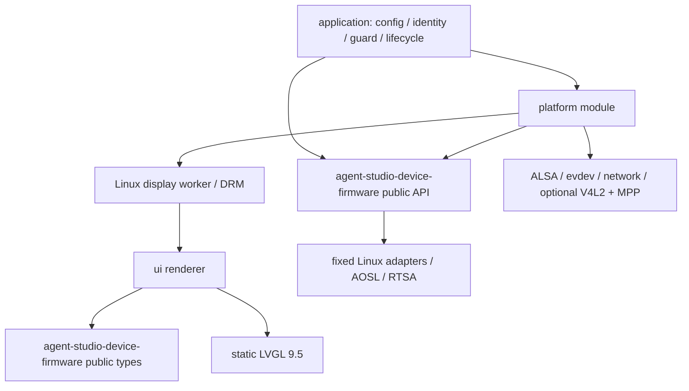

# 架构与资源归属

本项目是独立 Linux 用户态应用。板级驱动、系统网络/时间/ISP 服务继续由已有固件提供；agent-studio-device-firmware 1.3.0 负责配对、会话、RTC/RTM 和音频流水线。工程不创建第二套业务状态机。

```text
.
├── src/                   # 项目维护源码
│   ├── application/       # 配置、身份、保护与生命周期
│   ├── platform/          # 板型、Linux 服务与驱动
│   └── ui/                # 纯渲染、视图与字库
├── vendor/                # 分别锁定的依赖快照
│   ├── mybot/
│   ├── aosl/
│   ├── lvgl/
│   └── rtsa/              # 完整官方包
├── cmake/                 # 构建规则、工具链与依赖集成
├── tests/                 # 单元、集成与工具检查
├── tools/                 # 开发工具程序
├── scripts/               # 构建、检查、生成与打包自动化
├── packaging/             # 交付模板与运行配置
├── docs/                  # 当前指南、验证与历史
└── githooks/              # 提交信息校验
```



## 模块边界

| 位置 | 职责 / 资源 |
| --- | --- |
| `src/application/main.c` | 组织启动、信号/定时退出与统一清理，保持 SDK/UI 关闭顺序 |
| `src/application/config.*` | 环境/CLI 解析、范围校验和覆盖优先级；help/version 不触发运行资源 |
| `src/application/runtime_guard.*` | 旧服务/单实例互斥、私有存储准备与锁生命周期 |
| `src/application/device_identity.*` | CPU Serial / 永久 MAC 的稳定身份派生 |
| `src/platform/boards/rv1126b-test2-rk805b-v10/` | 唯一已记录板型的屏幕、旋转、ALSA、输入和相机默认值 |
| `src/platform/src/drivers/` | ALSA、evdev、DRM、像素旋转及可选视频硬件边界 |
| `src/platform/src/services/` | 网络监测、显示 worker 等 Linux 服务 |
| `src/ui/src/` | 固定画布 renderer、状态与表情策略 |
| `src/ui/views/pixel_glasses/` | 视图、图形、遮罩及对应来源声明 |
| `src/ui/fonts/` | 字体输入身份、已生成 C 字库及许可 |
| `cmake/dependencies/` | SDK、Linux adapters、LVGL 与系统库的构建包装 |
| `vendor/mybot/`、`vendor/aosl/`、`vendor/lvgl/`、`vendor/rtsa/` | 平级、分别锁定的依赖快照；RTSA 保留完整官方包 |
| `tools/ui_preview/` | 不启动设备栈的真实 LVGL 预览开发程序 |
| `scripts/` | 构建、检查、字库生成和打包自动化入口 |
| `packaging/` | 运行脚本、示例配置及交付说明模板 |

跨模块接口放入模块内的 `include/mybot_platform/` / `include/mybot_ui/`。源码目录简化后，公共头文件命名空间、CMake target 和链接依赖保持原名；驱动 ops、DRM 实现和 worker 细节保持私有。应用层装配平台、UI 和 SDK 生命周期，平台管理系统资源，UI 处理显示内容。平台通过 agent-studio-device-firmware 公共头文件接入 SDK，不能直接引用 SDK 私有实现。

UI 通过 present 回调交付画布，不依赖 DRM、ALSA、MPP 或 pthread。显示服务拥有线程和 DRM 资源；像素旋转 helper 是纯函数，host 测试/预览可单独复用，避免因此链接整个显示服务。逻辑画布尺寸由 UI 定义，物理模式与默认方向由板型定义。

## 生命周期契约

启动先解析并验证配置，再取得互斥、准备私有存储，启动显示与平台，最后接入 SDK 生命周期。失败走对应清理路径；已获得的线程/回调资源在销毁前等待完成。输入只发送已有 SDK 控制动作，不拥有会话状态。

显示 worker 在自身执行上下文调用 LVGL；renderer 接收有界状态副本。DRM backend 拥有 fd、buffers 和原显示状态，失败/正常退出时释放并恢复已保存的原输出。音频采集与播放维持各自生命周期，不能释放仍被回调使用的对象。视频初始化与启动分开，停止后不继续提交借用帧。

原厂 `botstation-device` 和本应用共享硬件；进程检查与锁共同阻止并行占用。设备现有 ISP、网络和时间服务不归本应用销毁。`/userdata/mybot-rv1126b` 保留绑定凭据，与版本解包目录分离。

## 兼容边界

工程治理保留 0.1.1 的命令行/环境名及优先级、server、身份算法、KV 路径、16 kHz mono S16/20 ms/Cloud AEC、显式开聊、原生 UI、默认旋转及表情行为。目标候选版仍需独立真机回归，旧验收结果不能覆盖新的二进制。

agent-studio-device-firmware、AOSL、LVGL、RTSA 快照与包装分离。父工程通过 `AOSL_DIR` 指定平级源码，由 SDK 创建唯一的 `aosl` target；源码布局不改变 SDK → AOSL/RTSA 的链接依赖。完整 RTSA 包内置于 `vendor/rtsa/`，父工程固定其公共头与 AArch64 动态库路径；运行包只携带所选目标库及适用说明。UI 视图与字库属于项目管理资源，不登记为第三方源码快照；字体作为生成源码编译进程序，不新增设备运行时字体依赖。依赖变更见[依赖指南](dependencies.zh-CN.md)和[目录规则](third-party-layout.zh-CN.md)，实际检查见[测试指南](testing.zh-CN.md)。
