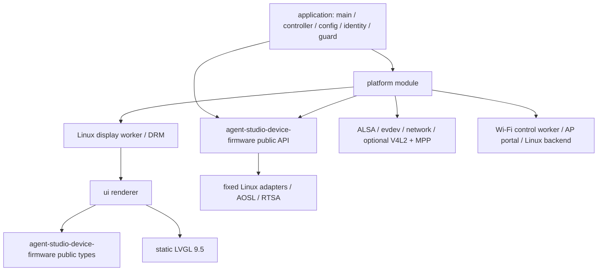

# 架构与资源归属

本项目是独立 Linux 用户态应用。板级驱动、系统时间/ISP 服务及网络工具继续由已有固件提供；agent-studio-device-firmware 1.3.0 负责配对、会话、RTC/RTM 和音频流水线。工程不创建第二套业务状态机。

```text
.
├── src/                   # 项目维护源码
│   ├── application/       # 配置、身份、保护与生命周期
│   ├── platform/          # 板型、Linux 服务与驱动
│   └── ui/                # 纯渲染、视图与字库
├── vendor/                # 分别锁定的依赖快照
│   ├── mybot/
│   ├── aosl/
│   ├── lvgl/
│   └── rtsa/              # 完整官方包
├── cmake/                 # 构建规则、工具链与依赖集成
├── tests/                 # 单元、集成与工具检查
├── tools/                 # 开发工具程序
├── scripts/               # 构建、检查、生成与打包自动化
├── packaging/             # 交付模板与运行配置
├── docs/                  # 当前指南、验证与历史
└── githooks/              # 提交信息校验
```



## 模块边界

| 位置 | 职责 / 资源 |
| --- | --- |
| `src/application/main.c` | 配置和稳定身份装配、信号、运行锁、环境/私有存储准备及最终退出码 |
| `src/application/controller.*` | 单一产品生命周期 owner，串行处理网络/授时门槛、SDK/配网切换、提示音、设置关机及服务回收 |
| `src/application/service_status.*` | 类型化应用状态与稳定 wire 名称映射，原子发布私有 `application.status` |
| `src/application/config.*` | 环境/CLI 解析、范围校验和覆盖优先级；help/version 不触发运行资源 |
| `src/application/runtime_guard.*` | 旧服务/单实例互斥、私有存储准备与锁生命周期 |
| `src/application/device_identity.*` | CPU Serial / 永久 MAC 的稳定身份派生 |
| `src/platform/boards/rv1126b-test2-rk805b-v10/` | 唯一已记录板型的屏幕、旋转、ALSA、输入和相机默认值 |
| `src/platform/src/drivers/` | ALSA、evdev、DRM、像素旋转及可选视频硬件边界 |
| `src/platform/src/services/` | 网络监测、显示 worker 等 Linux 服务 |
| `src/platform/src/services/network_route.*` | 共用只读 IPv4 地址/默认路由检查；不接管关联、DHCP 或恢复策略 |
| `src/platform/src/services/audio_volume.c` | 输出音量状态、私有持久化和 agent-studio-device-firmware 设备音量适配；播放驱动在写入 ALSA 前应用一次增益 |
| `src/platform/src/services/audio_prompt.c` | SDK 停机期间的独立 PCM 播放 worker、取消和声卡回收；不接管业务会话 |
| `src/platform/src/services/time_sync.c` | 网络就绪后的时间合理性检查、单调超时、既有服务检测及可选自有 helper 生命周期 |
| `src/platform/src/services/wifi/` | 独立 Wi-Fi 控制线程、AP HTTP/DNS 门户、Linux 网络后端及私有凭据存储 |
| `src/ui/src/` | 固定画布 renderer、状态与表情策略 |
| `src/ui/views/pixel_glasses/` | 视图、图形、遮罩及对应来源声明 |
| `src/ui/fonts/` | 字体输入身份、已生成 C 字库及许可 |
| `cmake/dependencies/` | SDK、Linux adapters、LVGL 与系统库的构建包装 |
| `vendor/mybot/`、`vendor/aosl/`、`vendor/lvgl/`、`vendor/rtsa/` | 平级、分别锁定的依赖快照；RTSA 保留完整官方包 |
| `tools/ui_preview/` | 不启动设备栈的真实 LVGL 预览开发程序 |
| `scripts/` | 构建、检查、字库生成和打包自动化入口 |
| `packaging/` | 运行脚本、示例配置及交付说明模板 |

跨模块接口放入模块内的 `include/mybot_platform/` / `include/mybot_ui/`。源码目录简化后，公共头文件命名空间、CMake target 和链接依赖保持原名；驱动 ops、DRM 实现和 worker 细节保持私有。应用层装配平台、UI 和 SDK 生命周期，平台管理系统资源，UI 处理显示内容。平台通过 agent-studio-device-firmware 公共头文件接入 SDK，不能直接引用 SDK 私有实现。

UI 通过 present 回调交付画布，不依赖 DRM、ALSA、MPP 或 pthread。显示服务拥有线程和 DRM 资源；像素旋转 helper 是纯函数，host 测试/预览可单独复用，避免因此链接整个显示服务。逻辑画布尺寸由 UI 定义，物理模式与默认方向由板型定义。

## 生命周期契约

main 先解析配置和稳定身份、取得互斥并准备环境/私有存储，再交由 controller 持有显示、输入、音量、授时、Wi-Fi、提示音和 SDK 的完整启停。失败走对应清理路径；已获得的线程/回调资源在销毁前等待完成。输入发送 SDK 控制动作或设置页配网请求，不拥有会话状态。手动配网仅由设置页“设备配网”触发；触屏和 Menu 长按不发布配网或会话事件，终端没有配网命令。controller 先关闭 SDK，再请求 Wi-Fi 服务进入 AP；UI 通过有界快照显示热点、地址与连接进度。

显示 worker 在自身执行上下文调用 LVGL；renderer 接收有界状态副本。DRM backend 拥有 fd、buffers 和原显示状态，失败/正常退出时释放并恢复已保存的原输出。音频采集与播放维持各自生命周期，不能释放仍被回调使用的对象。视频初始化与启动分开，停止后不继续提交借用帧。

视频 worker 的可 join 句柄与启动、运行、重试、失败和退出状态分别记录。初始化或采集/编码失败时，先回收自有 pipeline，再在同一会话内重试，总计最多三次；两次退避使用单调时间的 250/500 ms 等待，停止请求会立即唤醒退避。清理失败保留资源并停止重试，SDK 停止时先 join 再尝试回收。耗尽重试或清理失败经线程安全的平台健康查询回传应用，应用有序停止 SDK 并以失败退出，由现有监督器处理重启/退避；这一步会中断当前语音会话。普通错误期间的前两次恢复保留会话。

公开 SDK 的 start 接口及时接受异步启动，不同步调用帧 handler；不能把“等待超时但 worker 仍存活”伪装成 start 失败后允许销毁。初始化结果由 worker 状态发布，线程创建失败同步报告且不留下可 join 资源。现有 MPP 超时和采集轮询保持有效；不可返回的内核/MPP 调用没有被承诺为可取消或有界退出。停止会等待在途帧 handler，只有成功停止后才销毁上下文。

平台音量服务通过 `mybot_platform/volume.h` 在 SDK 初始化前恢复保存值，并通过 agent-studio-device-firmware 公共设备音量接口接入按键、终端和 RTM 控制。SDK 不再重复缩放输出，平台播放驱动在写入 ALSA 前对副本应用一次增益；原始 PCM、采集路径和系统 mixer 不变。云端 AEC 参考音频保留设备音量之前的信号，符合设备音量的接口语义，实际回声消除效果仍需真机回归。音量服务不随 SDK 停启销毁，因此手动配网不会重置音量。设置采用私有的 `MYBOT_KV_STORE_DIR/volume.settings`（0600）原子保存，只有持久化成功才发布新增益。

AP 提示音由产品生命周期通过 `mybot_platform/prompt.h` 触发，只有无线后端和门户均确认 active 才启动一次独立播放 worker，按 `MYBOT_LOCALE` 从资源目录读取 `wificonfig.pcm`。同一配网流程内的连接失败、页面刷新或单接口热点恢复不重新播报。提示音复用平台播放驱动与保存音量；SDK 和提示音不同时拥有声卡。离开 AP、退出或恢复 SDK 前先取消、等待 worker 退出并回收播放资源；提示音失败只报告错误，不将可用的 AP 配网标记为失败。

平台时间服务通过 `mybot_platform/time_sync.h` 接受主循环轮询，网络就绪且不在 AP 中时才开始单调计时。系统实时时钟达到 2026-01-01 只表示合理，不代表精确授时。默认不修改时间，仅等待 OS 服务；显式 helper 也只在时钟无效且 `/proc` 确认没有现成时间 daemon 时启动，检测失败不冒险并行校时。helper 以独立进程组前台运行，网络丢失/AP 切换/退出时取消并回收自有进程组、重置等待窗口，不停止系统服务。超时或 helper 失败经 UI/标准错误报告并阻止 SDK 启动；helper 退出但时钟仍无效同样失败。TLS 验证保持开启。

原厂 `botstation-device` 和本应用共享硬件；进程检查与锁共同阻止并行占用。设备现有 ISP、时间及外部网络管理服务不归本应用销毁。Wi-Fi 后端只停止本应用创建的子进程/虚拟接口，已附着的外部 supplicant 不被全局停止。`/userdata/mybot-rv1126b` 保留绑定凭据，与版本解包目录分离。

应用状态由 `rv1126b_app_state_t` 及一个 wire 名称表发布；它描述本进程的产品阶段，不复制 SDK 会话状态机，也不代表监督器状态。时钟展示采用 `mybot_display_clock_state_t`，避免跨模块传递含义分散的整数。现有状态文件字符串保持兼容。

网络观察器、Wi-Fi 控制服务及 Linux 后端共用 `network_route` 的基础地址/路由检查。后端额外排除本应用热点地址 `192.168.4.1`，关联状态、选定 profile、新租约代次和路由 fingerprint 继续由 Wi-Fi 后端核验，不能用通用“路由可用”替代凭据提交条件。SDK 网络观察器只产生连接事件，controller 持有产品恢复/SDK 停机策略。

## Wi-Fi 配网边界

Wi-Fi 模块由 C99 实现，`mybot_platform/wifi.h` 提供公共 C 接口；内部使用上下文结构体与操作函数表注入后端和门户，pthread 管理线程、互斥与条件等待。控制器串行执行扫描、连接、保存及 AP 切换。HTTP/DNS 各有独立 socket worker，处理线程只读取缓存快照或排队操作，连接尝试有总预算并支持取消。候选网络获得可用 IPv4 和路由后才更新私有凭据；SDK 在配网退出、网络就绪后恢复启动。

热点名保持 `mybot-xxxx` 共 10 字符。后端要求所选 STA 的 `addr_assign_type` 为 0，并校验完整六字节单播 MAC；对固定命名空间 `mybot:RV1126B:ap-ssid:v1:` 紧接六个二进制 MAC 字节计算 SHA-256，取摘要前两字节输出四位小写十六进制。文本大小写与末尾换行不影响结果；永久地址无法确认或格式无效时失败，不使用随机回退。该后缀只用于辨认屏幕上的热点，不保证全局唯一，也不用于认证或设备身份。

优先创建独立 AP 虚拟接口并保留 STA；单接口回退只接管本应用拥有的 STA，无法安全接管时明确报错。门户绑定 AP 地址，原生提供 HTTP 80 和 captive DNS 53；dnsmasq 只提供 DHCP，不与 DNS worker 争用 53 端口。HTTP 写操作要求同源 Origin、Host 和每次启动更新的 CSRF token，解析限制为 1 KiB header 与 1 KiB body；SSID/密码不进入 URL 或日志，页面使用 `textContent` 显示动态网络名称。DNS 不转发到外部服务器。

缓存最多 10 个网络；加密网络保存派生 PSK，文件采用原子私有写入，位于 `MYBOT_KV_STORE_DIR/wifi/wifi.credentials`。运行期配置和控制 socket 位于私有 session 目录；停止时取消尝试、等待线程、关闭端口并清理本应用拥有的运行资源，保留持久化配置。后端分别由 `wifi_backend.c` 编排、`wifi_wpa_control.c` 管理控制套接字、`wifi_process.c` 管理自有进程、`wifi_radio.c` 处理信道与扫描、`wifi_credentials.c` 管理私有凭据，`wifi_common.c` 提供有界缓冲区与单调时钟。运行工具及硬件前提见[配网指南](../user/wifi-provisioning.zh-CN.md)。

## 兼容边界

工程治理保持命令行/环境覆盖优先级、server、身份算法、KV 路径、16 kHz mono S16/20 ms/Cloud AEC、显式开聊、原生 UI、默认旋转及表情行为。手动配网入口统一为 UI 设置；离线启动与断网恢复的自动网络策略保留。目标候选版仍需独立真机回归，旧验收结果不能覆盖新的二进制。

agent-studio-device-firmware、AOSL、LVGL、RTSA 快照与包装分离。父工程通过 `AOSL_DIR` 指定平级源码，由 agent-studio-device-firmware 创建唯一的 `aosl` target；源码布局不改变 SDK → AOSL/RTSA 的链接依赖。完整 RTSA 包内置于 `vendor/rtsa/`，父工程固定其公共头与 AArch64 动态库路径；运行包只携带所选目标库及适用说明。UI 视图与字库属于项目管理资源，不登记为第三方源码快照；字体作为生成源码编译进程序，不新增设备运行时字体依赖。依赖变更见[依赖指南](dependencies.zh-CN.md)和[目录规则](third-party-layout.zh-CN.md)，实际检查见[测试指南](testing.zh-CN.md)。

## 设备部署边界

`mybot-supervisor` 独立监督应用及其自有子孙，使用私有 Unix 控制接口、有上限的重试和日志轮转；Linux 子进程收养结合 `/proc` 子关系及 `waitid(WNOWAIT)` 证明信号归属。异常强停不能证明 AP 内核资源已释放时，阻断再次启动和版本切换。

系统网络协作由 `system_wifi_profile.c` 负责主记录的解析、原子提交与回滚，dhcpcd hook 发布匿名租约代次。产品 Wi-Fi 控制线程只在 SDK 停止确认后进行断网恢复；SDK 的网络观察器继续负责业务连接事件。程序发布目录和私有运行数据相互独立，部署工具显式调用 ADB，构建和打包保持纯本地操作。

## 设置与计划关机

`mybot_ui/settings.h` 定义设置状态及渲染和点击共享的逻辑几何；UI 工作线程独占 LVGL，产品输入仅发布页面快照与操作请求。输入读取线程由应用持有，SDK key adapter 只绑定/解绑回调，解绑等待正在执行的回调，因而 AP 和首次绑定前也可操作设置。

应用主循环在网络等待和 SDK 运行期间都处理配网与关机请求。计划关机使用独立 C 客户端通过私有监督 socket 交互；监督器验证直接子进程身份，等待正常退出和后代清理后才执行系统关机。关机命令在普通监督配置中默认禁用，服务启动器显式选择板级命令；测试只注入自建的标记程序。
