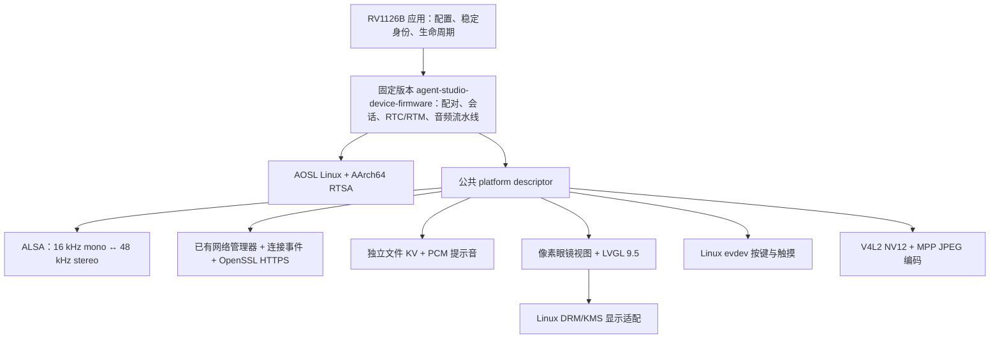

# agora-r2-pro-devkit RV1126B 移植可行性与实施方案

> 历史记录：本文保留对应阶段的判断、路径和命令，不作为当前操作指南。现行入口见[文档索引](../README.md)，结果以[验证状态](../validation/README.md)为准。

评估日期：2026-11-13。范围：本地源码、已有构建产物、瑞芯微官方资料，以及通过 ADB 对当前设备进行只读检查。本文记录实施前的方案；后续首版实现见[构建与验证记录](../validation/README.md)，上板步骤见[首版验证](first-validation.zh-CN.md)。

## 1. 结论与推荐路线

移植具备明确可行路径：将 agent-studio-device-firmware 1.3.0 作为固定依赖，在 RV1126B 现有 AArch64 Linux 上实现独立用户态应用。采用 Linux AOSL、Agora AArch64 RTSA 和板级 Linux 硬件接口；UI 使用工艺灰像素眼镜风格。

当前不需要重做内核、驱动或系统镜像。优先完成语音应用的本地交叉编译，再接入像素眼镜 UI 与摄像头；部署和硬件验收属于后续阶段。NPU 不在云端语音对话的必需依赖中，可在需要本地唤醒时单独接入。

现有资料支持上述路线，但尚未证明“当前 agent-studio-device-firmware 1.3.0 + 新 UI + 本板硬件”组合已能运行。本次没有上传文件、安装程序、运行新的设备应用、停止服务、修改配置、开流、设置混音器或执行 DRM modeset。

## 2. 资料与版本基线

本节记录评估时的官方资料和强依赖版本；依赖的当前身份与校验要求见[依赖指南](../development/dependencies.zh-CN.md)。

| 来源 | 本次核实的基线 | 用途与边界 |
| --- | --- | --- |
| [瑞芯微 RV1126B 官方介绍](https://www.rock-chips.com/a/cn/product/RV11xilie/2025/1208/2117.html) | 本次已获取网页 | SoC 能力；不能替代具体开发板、驱动与应用验证 |
| [agent-studio-device-firmware](https://github.com/AgoraIO-Community/agent-studio-device-firmware/blob/4c36cbee4fe8908b37ccee12dcebc0b17bc436f1/CMakeLists.txt) | 1.3.0，`4c36cbee4fe8908b37ccee12dcebc0b17bc436f1`，工作区干净 | 目标 SDK 与公共接口 |
| [AOSL 固定版本](https://github.com/AgoraIO-Community/agent-studio-device-firmware/blob/4c36cbee4fe8908b37ccee12dcebc0b17bc436f1/.gitmodules) | MyBot gitlink 为 `84e086084ebcd0ae2455a0ce5721950c5fe2e656` | SDK 固定的 AOSL Linux 源码依赖 |
| [目标 RTSA 来源](../dependencies/RTSA_SOURCE.txt) | 1.10.1，AArch64 Linux GNU，20 ms | 本地已有目标库、头文件与构建元数据 |

构建需要固定工具链、开发头文件、运行库快照及其清单，记录实际文件哈希与本地补丁；仅记录源码版本不足以复现目标产物。

## 3. 官方能力与当前设备

官方列出四核 Cortex-A53 + MCU、3 TOPS NPU、12M@30fps ISP / 8M@30fps AI-ISP、最多五路摄像头输入及最高 4K@45fps H.264/H.265 编码。这些能力足以支持云端语音与低分辨率视觉输入的技术路线；实际容量仍需测量。

本次设备只读实查结果如下：

| 项目 | 观察结果 | 对移植的影响 |
| --- | --- | --- |
| 设备树型号 | Rockchip RV1126B TEST2 RK805B V10 Board | 应建立这个开发板的独立配置 |
| CPU / 用户态 | 四核 Cortex-A53，`aarch64` | 使用 ELF64 little-endian AArch64，选择 Linux AOSL |
| 内存 | `MemTotal=2021036 kB`，约 2 GB | 初期没有 MCU 级内存约束；RTSA、视频、UI 峰值仍需实测 |
| 系统 | Buildroot 2024.02，Linux 6.1.172 | 现有 Linux 用户态应用路线成立 |
| libc / 加载器 | glibc 2.41，`/lib/ld-linux-aarch64.so.1` | libc 版本由与设备哈希一致的本地库字符串确认；设备无 `getconf` |
| 音频 | ALSA `hw:0,0` 同时存在采集和播放；当前为 48 kHz、双声道、S16_LE | SDK 侧需保持 16 kHz、单声道、S16 |
| ALSA 转换 | 已有 `/etc/alsa/conf.d/90-botstation.conf`，定义 `botstation_capture` / `botstation_playback` 的 `plug` 转换 | 可优先复用已有转换配置；通道内容和音质尚未验证 |
| 运行库 | ALSA 1.2.11、OpenSSL 3.2.1、libdrm、厂商 MPP | 可复用运行库快照；厂商 MPP 的头文件语义仍需核实 |
| 摄像头 | `/dev/video12` 为 `rkisp_mainpath`；`rkaiq_3A_server` 正在运行 | 采用 V4L2 + MPP 路线；保留系统 ISP 服务的所有权 |
| 显示 | `/dev/dri/card0`，DSI connected，480×640 | 可采用 DRM/KMS；逻辑横屏方向需后续真机确认 |
| 输入 | `axs_ts` 触摸节点及 `adc-keys` 按键节点 | 通过 Linux evdev 分别适配触摸与按键 |
| CA / 时间 | CA bundle 存在；设备 UTC 日期与评估日一致，`chronyd` 存在 | 具备 TLS 基础条件；未进行实际 HTTPS 握手 |
| 存储 | `/userdata` 独立分区，约 23 GB | 未来应用可使用独立 KV 目录；本次未读取已有凭据 |
| 开发环境 | 无 `/usr/include`、`gcc`、`cc` | 设备运行库不是完整开发 sysroot，应在主机交叉编译 |

另外，设备已运行 `/usr/bin/botstation-device`。其文件描述符显示已打开声卡、`/dev/video12`、`/dev/mpp_service` 和 `/dev/dri/card0`。采集流查询时为 RUNNING，播放流查询时为 XRUN；这只是瞬时状态，不足以判断原因或音质。本次未读取其日志、环境变量、凭据或网络消息，也未干预进程。

该设备程序与评估阶段既有本地应用产物的 SHA256 不同，不能用正在运行的程序证明本地新产物已通过上板验证。

## 4. 应用与平台结构



应用拥有配网、设备身份与硬件生命周期；SDK 继续拥有设备服务配对和会话状态。平台只使用 `include/mybot/` 的公共接口，按键和触摸依据 `mybot_get_state()` 发送语义事件，避免维护第二套会话状态机。

### 4.1 模块与接入清单

| 模块 | 实现方式 | 接入要求 |
| --- | --- | --- |
| AOSL | 当前 agent-studio-device-firmware 固定版本的 Linux HAL | 初始化固定依赖；无需新写 RV1126B HAL |
| RTC / RTM | 目标 RTSA 1.10.1 | 显式指定 AArch64 库及同一软件包头文件；ptime 使用 20 ms |
| 采集 / 播放 | `rv1126b_audio.c` | 对照 1.3.0 回调契约核查短 I/O、EAGAIN、XRUN、线程安全 stop 与资源销毁 |
| 网络状态 | `rv1126b_network.c` | 保留当前连接上报和断开/恢复通知；IPv4 地址与默认路由不等于服务可达 |
| HTTPS | 当前 agent-studio-device-firmware 的 `linux_https_openssl.c` | 复用新版实现；校验证书链、主机名、SNI；支持控制与后台 worker 的独立并发连接 |
| KV / 提示音 | 当前 agent-studio-device-firmware Linux 文件实现 | 新应用使用独立目录和语言资源；保留原子替换及访问权限语义 |
| 按键 | Linux evdev/keymap | 按板级能力选择键码；早期本地构建可采用 stdin 输入实现 |
| 触摸 | 新增 Linux evdev 适配 | 读取 `axs_ts` 事件，统一横屏坐标、短触与长按规则 |
| LCD / 表情 | 像素眼镜视图与显示策略 | 接入 Linux LVGL 9.5 owner，复制借用状态，使用单调时钟 |
| 视频 | RV1126B V4L2 + MPP | 初期使用完整 JPEG 帧上行；所有权、码率反馈和停流按当前公共接口实现 |
| 本地唤醒 | 后续可选 | 先关闭；有具体需求时评估 RKNN/其他本地 ASR 实现 |

SDK 必需的表为 Wi-Fi、KV、key、audio capture 和 audio playback；生产 HTTPS 配置还需要 HTTPS 表。LCD、提示音、硬件音量可选；视频和唤醒在对应构建开关开启时成为必需。

### 4.2 音频、身份与输入的具体差异

- SDK 音频接口计数为 PCM frames。20 ms 对应每路 320 帧、640 字节；保持云端 AEC 开启，参考信号来自播放设备实际接受的 RTC PCM，本地配对提示音不进入参考。无需新增第二条硬件参考采集通道。
- 已有 ALSA `plug` 可承担格式转换；仍需确认双声道分别是什么信号、混合后的麦克风质量、放音路径延迟与增益。48 kHz 双声道是当前观测配置，不能推断硬件只支持此格式。
- agent-studio-device-firmware 1.3.0 要求产品按固定身份输入和平台派生 key 生成 HMAC-SHA256，截取前 12 字节，形成 `RV1126B-<24 个大写十六进制字符>`，共 32 字符。独立缓冲至少 33 字节。公共头文件提到 MAC，移植指南允许稳定设备标识；优先确定可长期稳定的出厂 MAC，并固定规范化方法与派生 key。
- 已有设备身份和绑定不能根据格式相似推断兼容；身份派生规则必须固定，升级时保持身份与 KV 策略。本次没有生成新身份或更改绑定。
- 板载 `adc-keys` 的公开 capability bitmap 解码为键码 1、105、106、139，未声明 164（KEY_PLAYPAUSE），也未声明音量键。实际物理键映射需后续验证；默认键码应依据板级能力选择。
- 初期采用显式触发会话，首次 READY 后等待用户通过触摸、按键或终端开始。

## 5. UI：工艺灰像素眼镜

界面以像素镜框、工艺灰主题、四行终端和有限动画表达设备状态；当前实现的资源组织与线程边界见[架构指南](../development/architecture.zh-CN.md)。

### 5.1 视觉与状态行为

| 元素 | RV1126B 采用的方向 |
| --- | --- |
| 主题 | 固定工艺灰、像素镜框、黑色玻璃底 `#050708` |
| 配色 | 中性 `#F1F1EE`，终端 `#639589`，引导强调 `#F1CA79`，错误 `#E57876`；表情保留各自配色 |
| 主体 | 像素眼镜、眼睛与嘴部几何图形、小型蒙版和有限动画 |
| 四行终端 | 产品名改为 `> MyBot / RV1126B`；保留 mood、state / vp 状态和 `> agora / realtime`，以及 `</>` 签名 |
| 引导页 | 保留启动、等待网络、断网、连接服务、配对、配对码、失败和退出的中英文提示 |
| 配对码 | 大号数字，保留前导零；字体和容器随目标分辨率适配 |
| 声纹 | 会话状态行显示 `vp:ok` / `vp:pending` |
| 文案能力 | 当前 SDK 提供状态与指示位；聊天正文和实时字幕需要额外数据接口，不列入本次 UI 功能 |

保留全部 23 种表情资源；自动显示规则如下：

| SDK 显示状态 | 表情 |
| --- | --- |
| READY / 挂断返回 | NEUTRAL |
| 进入会话 | SURPRISED，保持 300 ms；动画开启时另计 250 ms 进入过渡 |
| LISTENING | LISTENING |
| THINKING | THINKING，连续 3 秒后 PROCESSING |
| SPEAKING / 无阶段 | NEUTRAL |

表情是显示策略，不推断声音幅度或用户情绪。普通阶段和声纹更新不重置开场计时；引导页面优先，离开会话后清理表情计时。关闭动画仍须更新状态并允许必要的长文案滚动。

### 5.2 分辨率与字体

建议默认采用 270° 旋转方向，将物理 480×640 映射为 640×480 横屏输出；实际方向和触摸变换留待上板确认。首版让 LVGL 继续按 320×240 设计坐标渲染，由 Linux 显示适配层执行 nearest-neighbor 2 倍整数放大并旋转到 framebuffer，保留像素风格、字体、四行终端和配对引导的比例。

原视图的几何会按宽度缩放，但终端 9 px、签名 10 px、中文 20 px 和配对码 32 px 字体是固定大小。首版统一放大输出后，对应可见字高为 18 / 20 / 40 / 64 px，无需先重建字体；产品名变长后的行宽仍须检查。后续若改用原生 640×480 渲染，则同时生成对应尺寸字库并调整排版。缩放与旋转统一由显示适配层完成，触摸按逆变换回到设计坐标。

保留现有字体来源与许可；当前中文子集覆盖固定 UI 文案，任意中文 SSID 需要补充字形。首版以状态、引导、配对码为范围。

### 5.3 LVGL 版本与 Linux 显示适配

视图采用 **LVGL 9.5.0 + C++17**。LVGL 8 与 9 的显示、图像、字体等 API 存在差异，目标应用应固定其依赖版本，避免链接到设备的 `liblvgl.so.8`。

推荐在本仓库固定 LVGL 9.5.0，从源码静态链接到新应用，接入像素眼镜视图与表情策略，并编写 Linux LVGL 9 显示适配。此方案保持视图与其依赖版本一致，也方便与设备现有应用隔离。所有直接和间接依赖也需统一，防止同一进程拉入 LVGL 8 的同名符号；后续交付需验证实际依赖表及 C++ 运行库。

| 部分 | Linux 接入要求 |
| --- | --- |
| `pixel_glasses_view.cc`、形状和蒙版、表情名称、状态映射、字体资源 | 使用 Linux 内存分配和独立平台配置 |
| `expression_policy.h` 的状态与单调时钟策略 | Linux UI owner 接收状态快照，维护表情提交时间与关闭顺序 |
| DRM 的连接器选择、dumb buffer、pitch、资源恢复逻辑 | 使用 LVGL 9 的显示注册、flush 和旋转接口 |
| 语义短触开始/挂断体验 | 使用 Linux evdev；长按三秒仅在配网流程实现后启用 |

Linux 采用一个 UI owner 线程处理 LVGL、显示刷新和定时器，SDK 的 LCD 回调只复制有界状态并通知它。使用单调时钟；不在音频热路径绘制。停止时先停接收与定时器，再释放视图、显示和 DRM 资源。

显示格式建议为与 DRM framebuffer 一致的 XRGB8888，显式处理行 pitch、放大后的刷新区域与旋转。DRM 后端采用单 scanout buffer，可能撕裂；先验证基本显示，再按需要增加 page flip。

## 6. 主机交叉编译与依赖方案

评估主机为 Intel macOS，已核对 Zig 0.15.2 的 `aarch64-linux-gnu.2.41` 包装工具链、设备运行库快照、固定版本开发头文件和 ELF 检查工具。方案在本仓库生成独立构建目录与依赖清单。

构建原则：

1. 固定当前 agent-studio-device-firmware 与 AOSL；主 SDK 目录不做板级修改。初始化其固定 AOSL 子模块，或在过渡构建中通过 `AOSL_DIR` 指向经过来源核对的同版本源码。
2. `CONFIG_PLATFORM=linux`；`MYBOT_BUILD_LINUX_PLATFORM=OFF`，按需编译新版 Linux KV、HTTPS、提示音等源文件；关闭 SDK 自带示例与目标测试。
3. 语音配置采用 `MYBOT_AUDIO_PTIME_MS=20`、`MYBOT_CLOUD_AEC=ON`、`MYBOT_ENABLE_HTTPS=ON`、`MYBOT_ALLOW_INSECURE_HTTP=OFF`、`MYBOT_WAKE_WORDS=OFF`，第一阶段关闭视频。
4. 显式提供同一 RTSA 包的 `AGORA_SDK_DIR` 和 AArch64 `AGORA_RTC_LIBRARY`，避免落入 SDK 自带的 x86_64 / 60 ms 默认值。
5. 用 Zig 自带的 libc 开发支持；仅有设备运行库的 staging 通过 `CMAKE_FIND_ROOT_PATH` 查找依赖，不能冒充完整 `CMAKE_SYSROOT`。有完整厂商 SDK 时可采用 Linux 上的 AArch64 GCC + 对应 sysroot。
6. 隔离 Homebrew / macOS 头文件和 pkg-config 路径。UI 阶段启用 C++17，明确静态或动态 C++ 运行库策略，检查 `libstdc++` / `libc++`、`libgcc_s`、`libatomic` 等实际依赖。
7. 对每个产物核查 ELF 架构、加载器、SONAME、RPATH、DT_NEEDED 依赖和符号版本；运行时加载的插件、CA、字体、ALSA 配置与语言资源另外列出。

目标库快照中的 libc、加载器、ALSA、SSL、Crypto、libdrm、MPP 共七项已在本次与设备 SHA256 复核一致。glibc 的目标版本应不高于设备，最终以产物实际要求的符号版本为准。

RTSA 包的 `PACKAGE_INFO` 标注 AArch64，但共享 `.config` 中 `CONFIG_PACKAGE_INFO` 含 x86_64 名称。本次选用库的实际 ELF machine 为 183（AArch64）；需要同时锁定库哈希、包来源和功能元数据，不能只按包名判断架构。

建议代码布局如下，均为待实施内容：

```text
mybot-rv1126b/
  app/                    配置、稳定身份、主生命周期
  platforms/rv1126b/      音频、网络、输入、KV 接线、视频
  ui/                     像素眼镜视图、表情策略、Linux LVGL 适配
  third_party/mybot/      固定版本 SDK 及其 AOSL 依赖
  cmake/toolchains/       macOS/Zig 与 Linux/GCC 工具链配置
  scripts/                依赖准备、本地构建、ELF 检查、打包
  docs/                   方案、来源与后续验证记录
```

## 7. 视频路线与资源预算

先采用 `/dev/video12` NV12 → MPP 硬件 JPEG → SDK 视频回调 → Agora 上行，目标为 640×480、最高 3 fps。码率范围为 100 kbit/s–1 Mbit/s，初值为中点 550 kbit/s；按反馈执行预算与丢帧。帧率和实际带宽仍需测量。

继续由系统 `rkaiq_3A_server` 管理 ISP。MPP 1.0.11 公开头文件与设备厂商库的符号可链接，不足以证明结构体、枚举和扩展语义完全匹配；视频阶段应优先获取对应 BSP 的 MPP 头文件与构建版本。

平台回调提交完整 JPEG，返回前保留借用数据；停止需等待编码任务与在途 handler 退出。SDK 不提供视频编码或下行画面。后续确有连续视频需求时，再扩展 H.264/H.265，并验证 Annex-B access unit、码率调整和关键帧请求。

SDK 文档中六个核心 worker 请求栈合计约 88 KiB，三个 PCM ring 各约 64 KB；这些是源码预算，不是进程峰值。目标预算还须包含 RTSA、TLS、ALSA、UI、视频 MMAP/MPP 缓冲与线程。当前 CMA 总量约 48 MiB，DMA/CMA 可用量应与普通堆内存分开观察。

## 8. 实施阶段与验收

| 阶段 | 交付内容 | 通过标准 | 设备操作边界 |
| --- | --- | --- | --- |
| P0：评估 | 本文、版本差异、设备基线、静态依赖结论 | 强依赖、设备事实与未验证条件明确 | 本次已完成，只读 |
| P1：语音本地构建 | 固定新版 SDK，RV1126B 音频/网络/输入与 HTTPS/KV，独立 AArch64 产物 | 编译链接通过；20 ms 一致；依赖检查通过；停止与失败路径的相关主机测试通过 | 仅写主机文件 |
| P2：像素眼镜 UI | LVGL 9.5 Linux 适配、320×240 设计画面的 640×480 输出、字体、状态与 23 表情 | 主机离屏检查两种语言、全部引导页、配对码前导零、行宽、表情计时、缩放/旋转及销毁 | 仅写主机文件 |
| P3：语音与显示上板 | 受控前台运行，独立配置/KV/日志；协调既有服务 | 配对、RTC/RTM、双向音频、扬声器全双工/AEC、触摸与显示方向通过；重复启停可释放资源 | 需要另行获得部署和硬件测试授权 |
| P4：视频与并行运行 | V4L2 + MPP JPEG，语音/UI/视频并行 | 服务端收到正确图像；码率反馈与停流有效；持续运行无持续内存增长，音频不中断 | 需要上板授权 |
| P5：产品化 | 配网、持久身份/凭据策略、自启动、升级与恢复 | 断网/重连、证书错误、进程退出、断电持久化及升级回归通过 | 后续产品阶段 |

P1 和 P2 可在本地独立推进。P3 前必须明确现有服务、网络、设备绑定和 KV 的处理范围；不能直接并行启动两个占用同一硬件的服务。首版调试建议采用独立应用目录与运行库路径，最终再集成系统服务。

声卡短读写/停止、HTTPS 失败与并发、UI 关闭与回调、视频失败清理应使用已有有意义的测试覆盖。硬件验收记录必须区分“编译”“主机桩/离屏测试”和“真机结果”。

## 9. 本次完成的验证与实际限制

已完成：

- 获取并核对官方网页；核对 SDK 公共头文件、目标依赖元数据和 Linux 硬件接口。
- ADB 只读确认系统、CPU、内存、声卡当前状态、公开 ALSA 配置、显示、输入、摄像头节点、服务占用和七项运行库哈希。
- 对评估阶段既有 AArch64 应用执行 ELF 检查，加载器、16 项传递依赖及符号版本检查通过，`errors=[]`。报告仅写入主机临时目录，该结果不等同于本项目产物已通过。
- 使用当前 agent-studio-device-firmware 的 CMake 校验函数，目标 RTSA 包通过 20 ms 与视频功能元数据检查。
- 解析目标 RTSA 动态符号表，当前 `mybot_agora_rtc.c` 引用的 16 个 `agora_rtc_*` / `agora_rtm_*` 函数名均存在。函数数量以当前源码统计为准。
- 执行像素眼镜视图的既有主机回归，适配器生命周期/状态策略与真实 LVGL 渲染器生命周期检查通过。构建与临时产物仅位于主机临时目录；本次未启用 sanitizer，该结果不代表 RV1126B UI 已完成。

关键文件校验值：

| 文件 | SHA256 |
| --- | --- |
| 本地目标 `libagora-rtc-sdk.so` | `0e878752644d94227c2aa5f3a9d2259c4098850297c867a2460cbbf8c66d3d98` |
| 评估阶段既有本地 AArch64 应用产物 | `45aef5903c081a6e7ce3636abf3e67501530a91282c8daf9f32facb4da6886ed` |
| 设备现有 `/usr/bin/botstation-device` | `88601b6b6d9ce25087183f0dc4a4fd8808053bcee48d0271cda810608b052ce9` |

未完成当前 agent-studio-device-firmware 1.3.0 的目标构建、函数/结构体的完整 ABI 验证、新 UI 的 RV1126B 适配、云端会话测试或任何新程序的上板运行。静态依赖检查不覆盖 `dlopen` 模块、配置/字体资源、驱动行为和业务效果；函数名存在也不证明运行语义一致。

当前最值得实施的下一步是 P1 的新版语音本地构建，并行完成 P2 的像素眼镜视图移植与离屏验证；它们都不要求修改设备文件。

## 10. 关键源码入口

- [当前平台描述符](https://github.com/AgoraIO-Community/agent-studio-device-firmware/blob/4c36cbee4fe8908b37ccee12dcebc0b17bc436f1/include/mybot/platform/mybot_platform.h)、[移植契约](https://github.com/AgoraIO-Community/agent-studio-device-firmware/blob/4c36cbee4fe8908b37ccee12dcebc0b17bc436f1/docs/PORTING.zh-CN.md)、[资源预算](https://github.com/AgoraIO-Community/agent-studio-device-firmware/blob/4c36cbee4fe8908b37ccee12dcebc0b17bc436f1/docs/EMBEDDED.zh-CN.md)。

固定依赖时同时记录源版本、内容哈希与必要许可；现行构建与验证入口见[文档索引](../README.md)。
