<!-- PDF source: python3 scripts/generate-device-manual.py --help -->

# 01 Prepare the Device and Materials

This manual covers application builds, installation and use on RV1126B TEST2 RK805B V10 with an existing AArch64 Buildroot system. It does not cover board flashing, system image creation or driver porting.

The system baseline is Linux 6.1 and glibc 2.41, with ALSA audio, DRM display, evdev input, CA certificates and time services. AP setup also requires wireless AP support and `ip`, `iw`, `hostapd`, `dnsmasq`, `wpa_supplicant`, `udhcpc`; supervised startup requires `amixer`. The device image must provide these board dependencies.

1. Prepare an Ubuntu 24.04 computer, a USB data cable, a device with a compatible system, and a phone for Wi-Fi setup.
2. Place the complete project on the computer and enter its root directory. Run all “host” commands there; enter the device first for “device shell” commands.
3. Obtain the target toolchain, development staging and device runtime manifest from the SDK maintainer. Ubuntu packages alone do not replace these inputs.
4. Prepare 2.4 GHz Wi-Fi, a service account and console address. Assign each new device a unique stable identity; retain the original identity and server for an existing device.

| Where | Purpose |
| --- | --- |
| Ubuntu host | Check, cross-compile, package; install and maintain through ADB |
| Device shell | Inspect board services and debug in the foreground |
| Touchscreen | Start/end conversations, open settings, set Wi-Fi and confirm shutdown |
| Phone browser | Join the device hotspot and enter home/office Wi-Fi |
| Web console | Sign in and claim the device with its pairing code |

Continue only when each step succeeds. Replace `/path/to/...`, `ADB_SERIAL_FROM_LIST` and the example device identity with actual values.

Images use the current English UI renderer with simulated states, hotspot `mybot-a1b2` and pairing code `000042`. They are illustrations, not device photographs or new hardware validation. Images show the upright logical canvas; use the text orientation on the physical screen as your guide.

<!-- page -->

# 02 Set Up Ubuntu 24.04

1. Install host development packages and ADB; check Python and CMake.

```sh
sudo apt update
sudo apt install build-essential pkg-config libssl-dev \
  libdrm-dev cmake python3 python3-venv adb
python3 --version
cmake --version
```

Expected: Python 3.10+ and CMake 3.25+. The Ubuntu 24.04 packages meet these minimums.

2. Create an isolated environment for the fixed formatting tools.

```sh
python3 -m venv local/dev-tools
local/dev-tools/bin/python -m pip install -r requirements-dev.txt
python3 scripts/doctor.py --host
python3 scripts/check-dependencies.py
python3 scripts/check-quality.py
```

Expected: all three checks succeed. The quality check selects the pinned clang-format 11 automatically; environment activation is unnecessary.

3. Run Chinese host tests, then repeat for English and UBSan.

```sh
cmake --preset host-zh
cmake --build --preset host-zh
ctest --preset host-zh
```

Replace `host-zh` in all three commands with `host-en`, then `host-ubsan`, and run each set. All tests should pass. These host executables cannot be deployed as device applications.

<!-- page -->

# 03 Configure the AArch64 SDK

1. Obtain the target development inputs below. Use actual absolute paths on the host.

| Input | Required content |
| --- | --- |
| Toolchain | GNU AArch64 C/C++, ar/ranlib, or the validated Zig 0.15.2 |
| staging | ALSA, OpenSSL and libdrm headers with matching AArch64 libraries |
| Video development files | Rockchip MPP headers and libraries for a bundle containing video |
| runtime manifest | manifest.json and runtime snapshot matching the device baseline |
| libc sysroot | Complete headers and startup objects if GNU requires them; a runtime snapshot is insufficient |

2. Choose one configuration below. The complete RTSA package is included in `vendor/rtsa/`; do not select an external copy.

With GNU, omit the last option if the toolchain already provides a complete sysroot:

```sh
python3 scripts/configure-local-sdk.py \
  --cross-compile /path/to/toolchain/bin/aarch64-linux-gnu- \
  --staging /path/to/sdk/staging \
  --runtime-manifest /path/to/runtime/manifest.json \
  --sysroot /path/to/libc-sysroot
```

Or use an already prepared Zig installation:

```sh
python3 scripts/configure-local-sdk.py \
  --zig /path/to/zig-0.15.2/zig \
  --staging /path/to/sdk/staging \
  --runtime-manifest /path/to/runtime/manifest.json
```

3. Check target dependencies.

```sh
python3 scripts/doctor.py --target --video
```

Expected: success, with `local/sdk/config.json` and `local/sdk/environment.sh` generated. Omit `--video` for a voice-only build. Keep the trailing `-` in the toolchain prefix. Personal SDK configuration stays in ignored directories.

<!-- page -->

# 04 Build Device Applications

1. Load the configured SDK environment in the same host terminal.

```sh
. local/sdk/environment.sh
```

2. Build English voice and video applications for the full bundle used below.

```sh
cmake --preset rv1126b-voice-en
cmake --build --preset rv1126b-voice-en
cmake --preset rv1126b-video-en
cmake --build --preset rv1126b-video-en
```

Expected: successful builds, including automatic ABI checks and build manifest generation. Outputs are `build/rv1126b-voice-en/` and `build/rv1126b-video-en/`.

3. For Chinese applications, build these configurations separately; do not mix language directories.

```sh
cmake --preset rv1126b-voice-zh
cmake --build --preset rv1126b-voice-zh
cmake --preset rv1126b-video-zh
cmake --build --preset rv1126b-video-zh
```

| Build language | Default service without an override |
| --- | --- |
| zh-CN | https://botstation.shengwang.cn/api |
| en-US | https://botstation.agora.io/api |

A full bundle includes both executables, but the device runs only one at a time. This manual's deployment settings select voice mode and leave the camera disabled. For voice only, build the matching voice configuration and package that variant as described next.

<!-- page -->

# 05 Package and Verify the Bundle

1. Read the source version and choose a fresh output directory on the host.

```sh
version=$(python3 scripts/project-version.py)
package_dir="$PWD/dist/manual-$(date +%Y%m%d-%H%M%S)"
python3 scripts/package-rv1126b.py \
  --profile all --language en-US --output-dir "$package_dir"
archive="$package_dir/mybot-rv1126b-${version}-en-US-aarch64.tar.gz"
archive_sha256=$(sha256sum "$archive" | awk '{print $1}')
printf 'Package: %s\nSHA256: %s\n' "$archive" "$archive_sha256"
```

2. Verify the archive and its internal file list.

```sh
(cd "$package_dir" && sha256sum -c "$(basename "$archive").sha256")
(cd "$package_dir/mybot-rv1126b-${version}-en-US-aarch64" && \
  sha256sum -c SHA256SUMS)
```

Expected: every entry is `OK`. Keep this terminal: deployment uses `archive`, `archive_sha256` and other variables. Set them again if you open a new terminal.

| Bundle | Options and filename changes |
| --- | --- |
| English, full | Commands above; includes voice and video |
| Chinese, full | `--language zh-CN`; omit `-en-US` from archive and directory names |
| Voice only | `--profile voice`; archive ends in `-aarch64-voice.tar.gz` |

Existing outputs are rejected; use a new directory. Rebuild stale inputs instead of editing manifests or disabling checks. Formal releases require a clean, committed source tree rebuilt with `--release`; this flow produces a candidate bundle.

A macOS host may deploy the Ubuntu-built bundle; use `shasum -a 256` there to calculate its archive digest. Builds and packaging do not connect to the device.

<!-- page -->

# 06 Connect and Set Private Configuration

1. Connect the powered-on device by USB data cable and select its serial number.

```sh
adb devices -l
serial='ADB_SERIAL_FROM_LIST'
adb -s "$serial" shell uname -m
adb -s "$serial" shell id -u
```

Expected: ADB state `device`, architecture `aarch64`, user `0`. Always select `serial` in later commands. Resolve offline/unauthorized connections first.

2. Assign a unique stable identity to a new device. Replace the placeholder `RV1126B-EXAMPLE-0001` below. For existing devices, reuse the original deployment settings and identity.

```sh
mkdir -p local/deployment
chmod 700 local/deployment
umask 077
cat > local/deployment/settings.json <<'JSON'
{
  "server": "https://botstation.agora.io/api",
  "device_id": "RV1126B-EXAMPLE-0001",
  "video": false,
  "wifi_interface": "wlan0"
}
JSON
chmod 600 local/deployment/settings.json
```

3. Check the identity, service region and Wi-Fi interface. IDs allow 1–32 ASCII letters, digits and `_.:-`. Never share the example ID between devices.

Only these four fields are accepted; do not add Wi-Fi passwords or authentication tokens. The example selects the international service. For China, use `https://botstation.shengwang.cn/api`. The explicit deployment `server` overrides language defaults. Preserve the original server, ID and data directory when upgrading a bound device.

<!-- page -->

# 07 Check and Install the Service

1. Run the read-only platform and identity check on the host.

```sh
python3 scripts/deploy-rv1126b.py preflight \
  --serial "$serial" --settings local/deployment/settings.json
```

Expected: platform ready; `auth=absent` is allowed for a new unbound device, while an existing identity must match. Correct mismatched settings; do not delete binding files to bypass checks.

2. Preview deployment and confirm the bundle, language and voice selection.

```sh
python3 scripts/deploy-rv1126b.py deploy \
  --serial "$serial" --settings local/deployment/settings.json \
  --package "$archive" --sha256 "$archive_sha256" --dry-run
```

3. Install. This writes the device and leaves the application stopped by default.

```sh
deploy_tag="manual-$(date +%Y%m%d-%H%M%S)"
python3 scripts/deploy-rv1126b.py deploy \
  --serial "$serial" --settings local/deployment/settings.json \
  --package "$archive" --sha256 "$archive_sha256" \
  --tag "$deploy_tag" --execute
```

Expected: deployment completes with a host receipt. The tool backs up on the device, verifies and installs an independent release, installs `S99mybot`, disables the previous application's autostart, writes board network policy and switches current. It does not reboot.

The backup stays on the device at `/userdata/mybot/backups/<tag>/original.tar.gz`. The host receipt is `local/deployment/<tag>/receipt.json`. A first installation may have no previous release; obtain an explicitly supplied known-good bundle from the maintainer if rollback is required.

<!-- page -->

# 08 Load Network Policy and Start

1. Keep USB ADB connected and reload the board's network services one at a time. These commands assume dhcpcd manages wlan0.

```sh
adb -s "$serial" shell /etc/init.d/S80dnsmasq restart
adb -s "$serial" shell /etc/init.d/S41dhcpcd restart
adb -s "$serial" shell dhcpcd -n wlan0
```

Expected: each command succeeds. Network access may briefly drop. Deployment `--start` does not replace this step. Preserve time, ADB and power services, plus `rkaiq_3A_server`.

2. If Wi-Fi already works, check the lease hook record.

```sh
adb -s "$serial" shell test -s \
  /run/mybot-network/leases/wlan0.lease
```

A new device without Wi-Fi may lack a valid lease. Confirm the interface and hook are ready, then start and follow the AP instructions on screen.

3. Start the supervised service and inspect status.

```sh
adb -s "$serial" shell /etc/init.d/S99mybot start
python3 scripts/deploy-rv1126b.py status --serial "$serial"
adb -s "$serial" shell cat /run/mybot-rv1126b/application.status
adb -s "$serial" shell /userdata/mybot/current/run.sh --version
```

Expected: the service runs with the installed version. An online, bound device eventually reaches `ready`; a new device may show `ap`, `waiting_network` or `pairing`. Follow the next sections.

Deployment status and `S99mybot status` report release links and process supervision. Check `state` in `application.status` and the screen for application readiness. Do not start a second `run.sh` instance.

<!-- page -->

# 09 Power On and Read Startup Screens

1. Hold the device's single physical button to power on; release when the startup screen appears. A long press is confirmed to switch this device on/off; follow its response rather than a fixed duration.
2. Once installed, the supervised service starts automatically at boot. It reuses available Wi-Fi or waits for networking before showing setup instructions.

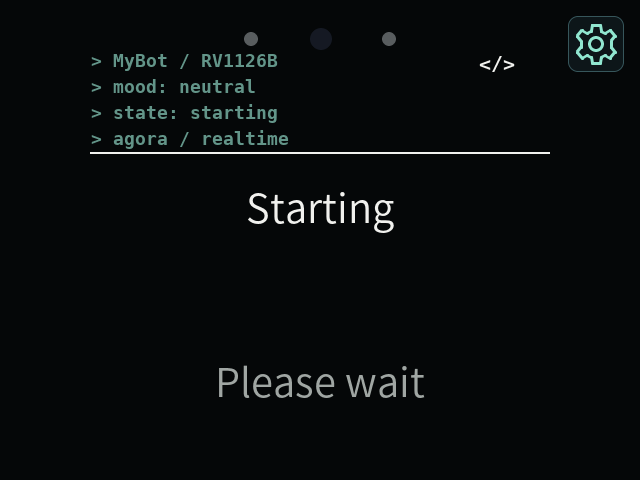
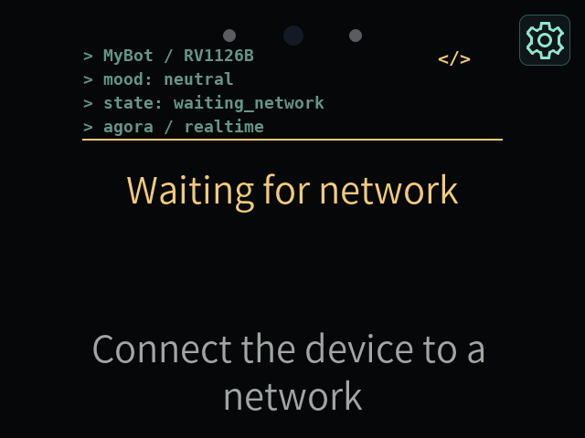
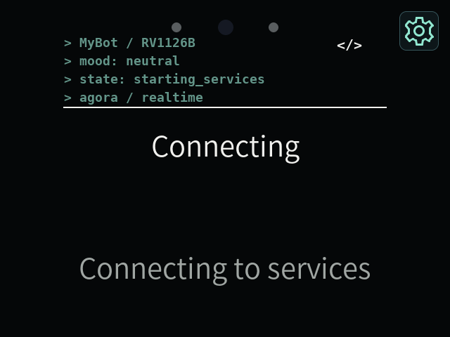
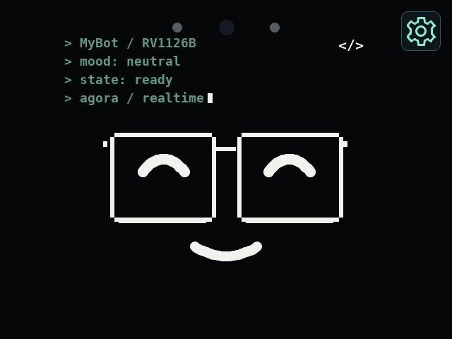

3. A bound device eventually shows pixel glasses and `state: ready`; a new device shows a pairing code. Conversations do not start automatically: tap the screen to begin.

The top-right gear opens settings, including during network setup and first pairing. A computer is unnecessary for daily use.

<!-- page -->

# 10 Set Up Wi-Fi with Your Phone

1. If saved networks cannot be restored, AP setup starts automatically. To change working Wi-Fi, tap the top-right gear, then “Wi-Fi setup”.

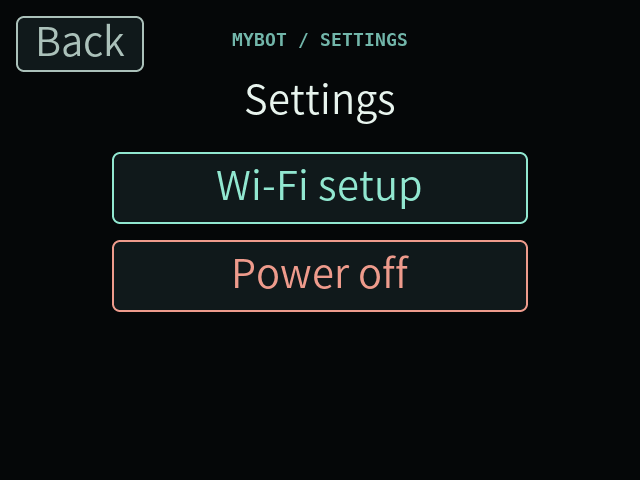
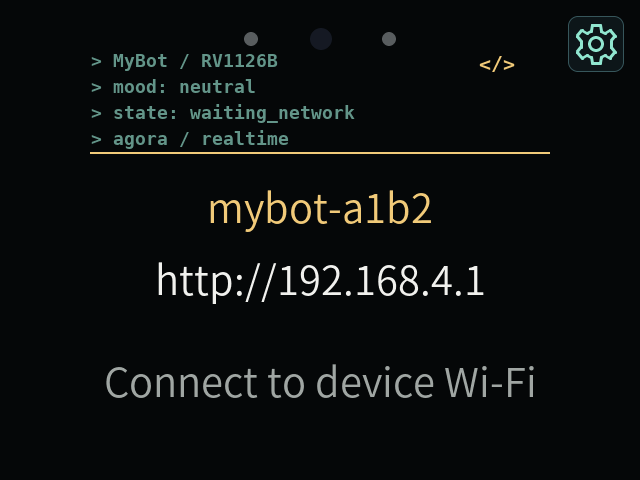

2. In your phone's Wi-Fi settings, join the displayed `mybot-xxxx` hotspot. It has no password. Choose to stay connected if the phone reports no internet.
3. Wait for the setup page to open. If it does not, browse to `http://192.168.4.1/` using HTTP.
4. Select a 2.4 GHz network and enter its password. Enter hidden network names manually; leave the password blank for an open network.
5. Tap Connect and wait. System mode also verifies association, lease and routing, so “Connecting” may remain visible.
6. When the page reports success, tap Done or wait for automatic exit. The hotspot closes and the application starts. Your phone can rejoin its usual network.

Expected: the device moves from waiting for network to connecting services, then pairing or ready. With one wireless interface, the hotspot may drop during connection; if it fails, reconnect to the device hotspot and retry. Phone success alone does not mean cloud services are ready: check the device screen.

<!-- page -->

# 11 Pair and Claim the Device

1. After Wi-Fi setup, wait for the pairing code. The device displays and reads it at the saved volume; mute disables speech.

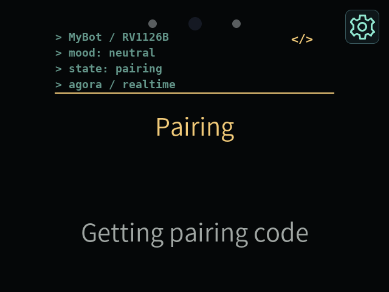
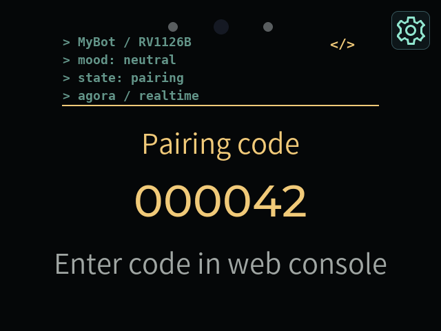

2. Remove the trailing `/api` from the configured server address to obtain the web console URL. Open it on a phone or computer and sign in.
3. Follow the console's device claim flow and enter the complete code currently displayed, including leading zeros. The illustrated `000042` is not a real device code.
4. Wait for the claim to complete and the device to reach `state: ready`. If the code expires, use the new one shown on the device.

| Service region | Web console |
| --- | --- |
| China | https://botstation.shengwang.cn |
| International | https://botstation.agora.io |

For server `https://botstation.shengwang.cn/api`, open `https://botstation.shengwang.cn`. With other deployments, remove only the trailing `/api` and leave the rest unchanged. Normal boots, upgrades and Wi-Fi changes reuse the binding; claiming again is usually unnecessary.

<!-- page -->

# 12 Start and End a Conversation

1. On ready, tap an ordinary screen area away from the gear. A valid tap lasts 50–999 ms.
2. Wait for listening, then speak. Watch the status line.


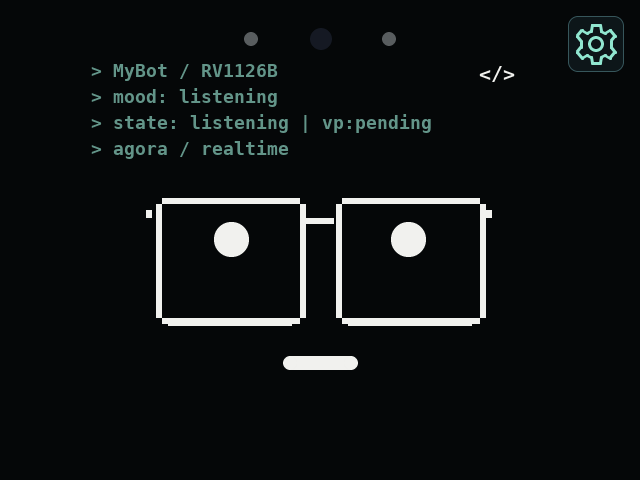
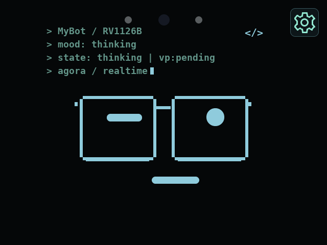
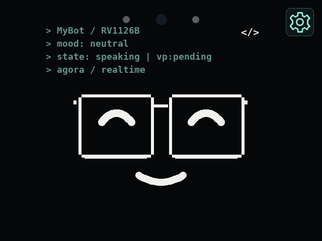

3. Tap an ordinary area again to end the conversation and return to ready. Holding the screen starts neither a conversation nor Wi-Fi setup.

`vp:pending` means voiceprint registration is pending; `vp:ok` means it is complete. No separate tap is needed. Expressions represent application stages, not measured microphone levels. PROCESSING may appear after about 3 seconds of thinking; this alone is not a fault.

<!-- page -->

# 13 Settings and Changing Wi-Fi

1. Tap the top-right gear to open settings. Tap Back at top left to close it. Menu touches do not start or end conversations.


2. Choose “Wi-Fi setup” to change networks. The application first ends the conversation and stops the SDK, then enters phone AP setup.
3. Complete section 10 and wait for ready. The binding is retained; tap again to start a new conversation.
4. The phone portal's saved networks list supports selecting a default or deleting entries, up to 10 networks. A successful new connection becomes the default; deleting the default promotes the next entry.

Settings is the only manual Wi-Fi setup entry. Screen holds, terminal `w` and the old `--wifi-provision` option no longer start setup. Offline attempts to restore saved Wi-Fi, followed by automatic AP setup, remain enabled.

An explicit `--no-wifi-provisioning` disables automatic and manual AP setup; settings will not open a hotspot. Standard supervised deployment enables setup by default.

<!-- page -->

# 14 Volume and Language Settings

1. Adjust playback volume using the service's supported device volume control. This device has only a physical power button; settings has no volume slider.
2. Check mute, low and normal playback levels. The range is 0–100, with 0 muted; the initial default is 100.
3. Restart the application or complete Wi-Fi setup and confirm the volume returns. Setup prompts and pairing speech also use saved volume and remain silent when muted.

| Setting | Effect |
| --- | --- |
| zh-CN / en-US build | Device UI, fonts and default service region unless overridden |
| MYBOT_LOCALE | Bundled prompt language only; does not change UI or server |
| Phone portal Chinese / English | Phone setup page only; does not change device UI or speech |
| --server / RV1126B_SERVER | Explicit service; overrides the build language default |

For foreground diagnostics, maintainers can use `u` / `d` as described in section 17. A separate ADB shell is not the background application's terminal: typing `u` / `d` there does not control the service.

There are no battery, brightness, automatic sleep or OTA menus. Application playback volume does not change the capture mixer; the deployment service applies separate board capture initialization.

<!-- page -->

# 15 Shut Down and Power On Again

1. Open the top-right gear and choose “Power off”.
2. Tap Cancel to return, or confirm shutdown.

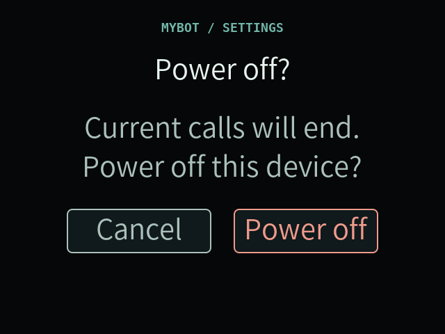
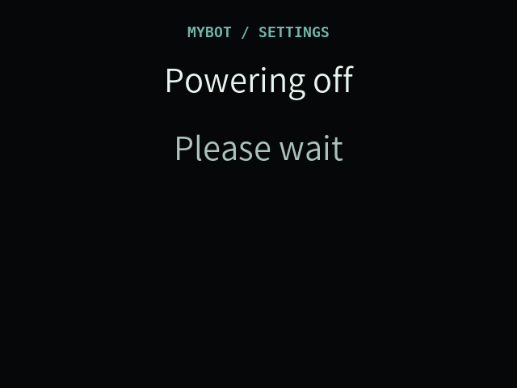

3. Wait for audio, network and display cleanup and normal system shutdown. Do not keep touching the screen.
4. To power on again, hold the single physical button until the startup screen appears, then release. A long press is confirmed to work; no fixed duration is prescribed.

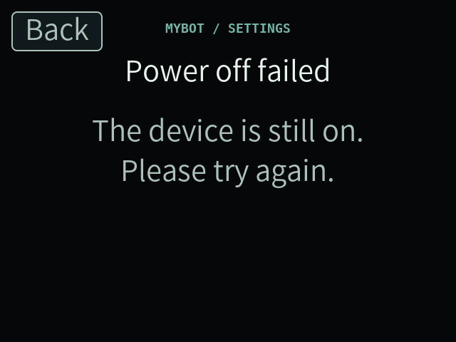

Screen shutdown requires authorization from the supervised service started by `S99mybot`. A temporary foreground `run.sh` reports shutdown failure; return to keep using it. For a deployed service failure, inspect status and logs.

Exiting the application or stopping `S99mybot` does not power off the device. UI confirmation makes the supervisor call `/sbin/poweroff`; the system power service handles the physical button.

<!-- page -->

# 16 Inspect and Maintain the Service

Run these commands on the host using the selected `serial`.

1. Check application/supervisor state, version and release links.

```sh
python3 scripts/deploy-rv1126b.py status --serial "$serial"
adb -s "$serial" shell /etc/init.d/S99mybot status
adb -s "$serial" shell cat /run/mybot-rv1126b/application.status
adb -s "$serial" shell /userdata/mybot/current/run.sh --version
adb -s "$serial" shell readlink /userdata/mybot/current
adb -s "$serial" shell readlink /userdata/mybot/previous
```

The final command may return no version after a first installation without previous. `--version` selects the default executable; the service's video selection also depends on `RV1126B_VIDEO` in private configuration.

2. Choose the operation you need; these are alternatives, not a required sequence.

```sh
adb -s "$serial" shell /etc/init.d/S99mybot stop
adb -s "$serial" shell /etc/init.d/S99mybot start
adb -s "$serial" shell /etc/init.d/S99mybot restart
```

3. Inspect recent logs locally when troubleshooting.

```sh
adb -s "$serial" shell tail -n 100 /userdata/mybot/logs/mybot.log
adb -s "$serial" shell date -u
adb -s "$serial" shell ip route
```

Logs may contain identities, hotspot names or pairing details; redact before sharing. If the supervisor has an unclean marker, do not delete it to force a restart. Follow section 21 for resource cleanup faults.

<!-- page -->

# 17 Foreground Debugging and Controls

Use this only for maintenance; keep the supervised service for daily use.

1. Stop the service from the host. Confirm success, then enter the device shell.

```sh
adb -s "$serial" shell /etc/init.d/S99mybot stop
adb -s "$serial" shell
```

2. In the device shell, load the existing service configuration to preserve server, identity and data directory, then run in the foreground.

```sh
. /etc/mybot-rv1126b.conf
/etc/mybot-rv1126b/audio-prepare.sh
cd /userdata/mybot/current
./run.sh
```

| Input, then Enter | Action |
| --- | --- |
| s / q | Start from ready / end a conversation |
| u / d | Increase / decrease saved playback volume |
| p | Request pairing again; use only when needed |
| e or Ctrl-C | Exit normally |

The supervised service uses `/dev/null` for stdin. These controls work only in the foreground application's terminal. If terminal input is disabled, use the screen or service controls.

3. After a normal foreground exit, restore the background service in the device shell, then leave the shell.

```sh
/etc/init.d/S99mybot start
exit
```

Do not run foreground and background instances together. Foreground mode lacks the supervisor's poweroff authorization; restore the service before using screen shutdown.

<!-- page -->

# 18 Upgrade and Roll Back

1. Keep the accepted old bundle and private settings. Assign a new version for source changes: a different archive cannot overwrite an installed release with the same name.
2. Update the version, then rebuild and package. Replace `X.Y.Z` with an actual new version; do not run the literal placeholder.

```sh
python3 scripts/project-version.py --set X.Y.Z
python3 scripts/project-version.py --check
```

3. Repeat sections 04–08 using a fresh output directory, digest and deployment tag. Existing devices keep their settings and must pass binding checks. When required by the release process, commit first and rebuild the formal release bundle.
4. Wait for ready, check voice, settings, Wi-Fi and volume, then record the bundle digest and acceptance result.

If a verified previous release exists, preview rollback on the host, then execute:

```sh
python3 scripts/deploy-rv1126b.py rollback \
  --serial "$serial" --settings local/deployment/settings.json \
  --dry-run
python3 scripts/deploy-rv1126b.py rollback \
  --serial "$serial" --settings local/deployment/settings.json \
  --execute --start
```

Expected: previous runs with the same data directory, supervisor and binding. Rollback does not restore old Wi-Fi/authentication data or enable the original application. After a first installation without previous, ask the maintainer which verified release is installed; rollback needs an actual target.

<!-- page -->

# 19 Paths and Persistent Data

Programs and user data are stored separately. Preserve identity, binding, Wi-Fi and volume when changing application versions.

| Device path | Purpose |
| --- | --- |
| /userdata/mybot/releases/ | Independent application releases |
| /userdata/mybot/current | Relative link to the current release |
| /userdata/mybot/previous | Previous release link; may not exist after first install |
| /userdata/mybot/backups/<tag>/original.tar.gz | Predeployment backup, retained only on the device |
| /userdata/mybot/logs/mybot.log | Current service log, with rotated files |
| /userdata/mybot-rv1126b/device_auth | Binding/authentication record; contains sensitive data |
| /userdata/mybot-rv1126b/volume.settings | Saved playback volume |
| /etc/wpa_supplicant.conf | System Wi-Fi master record in supervised deployments |
| /userdata/mybot-rv1126b/wifi/wifi.credentials | Private Wi-Fi mode record; system mode uses the system master |
| /etc/init.d/S99mybot | Service control and boot entry |
| /etc/mybot-rv1126b.conf | Root-private service configuration, mode 0600 |
| /etc/mybot-rv1126b/ | Stable supervisor, launch and audio preparation scripts |
| /run/mybot-rv1126b/application.status | Temporary application state, recreated after reboot |
| /run/mybot-network/leases/wlan0.lease | Temporary lease generation record, without Wi-Fi passwords |
| /run/mybot-rv1126b-service/ | Supervision control and quarantine markers |

Do not fix startup by deleting `device_auth`, the Wi-Fi master record or the private directory. Redact identities, pairing codes and credentials from reports. Keep backups under the device's private permissions.

<!-- page -->

# 20 Network, Clock and Startup Faults

Record the version, screen state and nearby failure logs before troubleshooting.


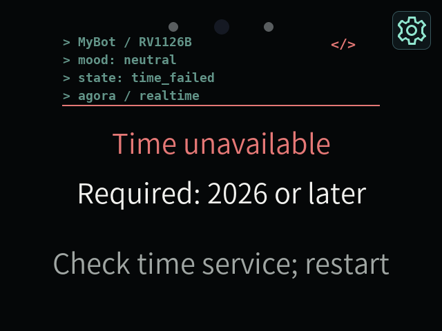

| Symptom | Action and expected result |
| --- | --- |
| Stuck waiting for network | Check Wi-Fi, IPv4 and default route; use settings to reconnect. Check the dhcpcd hook if online without a lease record |
| No phone setup page | Stay on the mybot hotspot and open http://192.168.4.1/ |
| Wrong password / hotspot disappears | Wait for the attempt to finish; rejoin the restored hotspot and retry |
| Phone succeeds, device still waits | Check routing, DNS, time and CA; inspect application state, not just the phone message |
| Time unavailable | Check date and time services; default wait is 30 seconds after networking, with time no earlier than 2026-01-01 UTC |
| Service connection / TLS failure | Check regional HTTPS address, DNS, CA, time and connectivity |

The clock threshold rejects obviously invalid dates; it does not prove accurate NTP synchronization. Keep system time services. If needed, a maintainer can configure the optional BusyBox helper using the time guide; time synchronization is not started during Wi-Fi setup.

<!-- page -->

# 21 Build, Deployment and Audio Faults

| Symptom | Action and expected result |
| --- | --- |
| Missing local/sdk/config.json | Complete section 03; Ubuntu host packages do not replace the target SDK |
| Host format check fails | Use pinned clang-format 11 in local/dev-tools and fix the reported error |
| Target ABI / RTSA check fails | Verify staging, manifest, complete RTSA and architecture; do not edit digests to bypass checks |
| Stale build or missing variant | Rebuild the selected language/profile; all needs both voice and video from matching sources |
| Bundle / release name conflict | Keep the old bundle and use a new output directory; bump the version for an installed release with a different digest |
| Identity mismatch | Use the original server and ID; preserve data, never delete the binding |
| existing service / lock | Stop the owner normally and confirm exit; do not run two instances |
| ALSA busy / no sound | Check sound device ownership, saved mute volume and ALSA log errors |
| No speech response / AEC fault | Confirm listening and networking, then inspect board capture policy and audio logs |
| Screen shutdown fails | Use the service supervised by S99mybot; foreground mode lacks authorization |
| unclean / restart blocked | Preserve the scene; inspect remaining process groups, AP, audio/video and private logs; ask the maintainer to recover |

Never delete unclean to bypass protection. A maintainer must assess the device before rebooting to clear kernel resources; deployment does not reboot automatically.

Reports should include bundle name, SHA256, version, language/video selection, reproduction steps and redacted logs. Audio quality, AEC, phone access and long runs require hardware evidence; host tests cannot replace it.

<!-- page -->

# 22 Optional Video and Acceptance

The camera application is implemented but needs separate validation. Passing voice checks does not prove video works.

1. Confirm the bundle contains video and that ISP services, V4L2 and MPP work. Keep a working voice release before enabling it.
2. Set `video: true` in deployment settings, preview and deploy. This writes service configuration; it is not a screen toggle. Use normal deployment to avoid concurrent instances.
3. Once ready, tap to start a conversation and check the first cloud frame and reception. Verify orientation, colors and 640×480 JPEG at up to 3 fps. Tap to end and confirm streaming stops; restart to check recovery and voice/UI concurrency. Ready alone produces no frames. There is no local preview or automatic snapshot storage.

After each installation or upgrade, check these in order and record bundle SHA256, version, date and result:

| Step | Acceptance criterion |
| --- | --- |
| 1. Version and startup | Correct checksums, one application instance; ready or initial pairing |
| 2. Wi-Fi | Phone finds hotspot, receives address, submits/saves Wi-Fi; application recovers |
| 3. Binding | Complete code claims device; upgrades and Wi-Fi changes retain binding |
| 4. Voice | Repeated start/end, two-way audio and consistent states |
| 5. Settings | Gear and top-left Back work; holding does not start Wi-Fi setup |
| 6. Volume | Mute/adjustment work and survive restart/setup |
| 7. Power | UI shutdown succeeds; physical button powers on and service autostarts |
| 8. Optional checks | Record video, AEC, network recovery and endurance separately |

Detailed references: build `docs/user/build.zh-CN.md`, deployment `docs/user/deployment.zh-CN.md`, Wi-Fi `docs/user/wifi-provisioning.zh-CN.md`, configuration `docs/user/configuration.zh-CN.md`. Recorded validation scope is in `docs/validation/README.md`.
