<!-- PDF source: python3 scripts/generate-device-manual.py --help -->

# 01 准备设备和资料

本手册面向 RV1126B TEST2 RK805B V10，覆盖现有 AArch64 Buildroot 系统上的应用构建、安装和使用。它不包含裸板烧录、系统镜像制作或硬件驱动移植。

系统基线为 Linux 6.1、glibc 2.41，需提供 ALSA 音频、DRM 显示、evdev 输入、CA 与授时服务。AP 配网另需无线 AP 驱动和 `ip`、`iw`、`hostapd`、`dnsmasq`、`wpa_supplicant`、`udhcpc`；受监督启动需 `amixer`。这些板级条件由设备镜像提供。

1. 准备一台 Ubuntu 24.04 开发电脑、一根支持数据传输的 USB 线、已安装兼容系统的设备，以及一部用于配网的手机。
2. 将完整工程放到开发电脑，进入仓库根目录。后续“主机”代码块均在这个目录执行；“设备 shell”代码块需先进入设备。
3. 向 SDK 维护方取得目标工具链、开发 staging、设备运行库 manifest。仅安装 Ubuntu 软件包不能替代这些输入。
4. 准备可用的 2.4 GHz Wi-Fi、对应服务的账号和控制台地址。新设备先分配唯一稳定身份；旧设备沿用原身份及服务地址。

| 执行位置 | 用途 |
| --- | --- |
| Ubuntu 开发主机 | 检查、交叉编译、打包；通过 ADB 安装和维护 |
| 设备 shell | 检查板级服务、临时前台调试 |
| 设备触摸屏 | 发起/结束对话，设置、重新配网和确认关机 |
| 手机浏览器 | 连接设备热点并填写家庭/办公 Wi-Fi |
| 服务网页控制台 | 登录账号，输入配对码认领设备 |

每一步成功后再继续。示例中的 `/path/to/...`、`ADB_SERIAL_FROM_LIST` 和示例设备身份都需要替换；不要直接照抄为真实配置。

配图来自当前中文 UI 渲染器，使用模拟状态、示例热点 `mybot-a1b2` 和示例配对码 `000042`，并非设备拍摄或新的真机验收。图中按正向逻辑画面展示，便于辨认文字和按钮；实际设备以屏幕文字方向为准。

<!-- page -->

# 02 安装 Ubuntu 24.04 开发环境

1. 在主机安装开发包和 ADB，检查 Python 与 CMake 版本。

```sh
sudo apt update
sudo apt install build-essential pkg-config libssl-dev \
  libdrm-dev cmake python3 python3-venv adb
python3 --version
cmake --version
```

预期：Python 3.10 或更新，CMake 3.25 或更新。Ubuntu 24.04 软件源提供的版本满足最低要求。

2. 在仓库中创建隔离的格式工具环境。

```sh
python3 -m venv local/dev-tools
local/dev-tools/bin/python -m pip install -r requirements-dev.txt
python3 scripts/doctor.py --host
python3 scripts/check-dependencies.py
python3 scripts/check-quality.py
```

预期：三项检查成功。质量检查自动选择固定的 clang-format 11；无需激活虚拟环境。

3. 运行主机中文测试；同样检查英文和 UBSan 配置。

```sh
cmake --preset host-zh
cmake --build --preset host-zh
ctest --preset host-zh
```

将三条命令中的 `host-zh` 依次换成 `host-en`、`host-ubsan`，各执行一次。预期每套测试全部通过。这些是主机测试，生成的程序不能作为设备应用部署。

<!-- page -->

# 03 配置 AArch64 目标 SDK

1. 确认已取得下列目标开发输入，路径全部使用本机实际绝对路径。

| 输入 | 必需内容 |
| --- | --- |
| 工具链 | GNU AArch64 C/C++、ar/ranlib，或已验证的 Zig 0.15.2 |
| staging | ALSA、OpenSSL、libdrm 开发头文件及匹配的 AArch64 库 |
| 视频开发文件 | 制作含视频的全配置包时，还需要 Rockchip MPP 头文件和库 |
| runtime manifest | 匹配设备基线的 manifest.json 及运行库快照 |
| libc sysroot | GNU 工具链需要时提供完整头文件和启动对象；运行库快照不能代替它 |

2. 以下两种配置方式选择一种。RTSA 已完整内置于 `vendor/rtsa/`，无需另外指定外部 RTSA。

使用 GNU 工具链；工具链自带完整 sysroot 时可省略最后一项：

```sh
python3 scripts/configure-local-sdk.py \
  --cross-compile /path/to/toolchain/bin/aarch64-linux-gnu- \
  --staging /path/to/sdk/staging \
  --runtime-manifest /path/to/runtime/manifest.json \
  --sysroot /path/to/libc-sysroot
```

或使用已准备好的 Zig：

```sh
python3 scripts/configure-local-sdk.py \
  --zig /path/to/zig-0.15.2/zig \
  --staging /path/to/sdk/staging \
  --runtime-manifest /path/to/runtime/manifest.json
```

3. 检查目标依赖。

```sh
python3 scripts/doctor.py --target --video
```

预期检查成功，且已生成 `local/sdk/config.json` 和 `local/sdk/environment.sh`。若只制作语音包，可省略 `--video`；工具链前缀末尾的 `-` 需要保留。个人 SDK 配置位于忽略目录，不纳入源码提交。

<!-- page -->

# 04 编译设备程序

1. 在主机的同一个终端加载已配置的 SDK 环境。

```sh
. local/sdk/environment.sh
```

2. 编译中文语音及视频程序，供下一步制作全配置包。

```sh
cmake --preset rv1126b-voice-zh
cmake --build --preset rv1126b-voice-zh
cmake --preset rv1126b-video-zh
cmake --build --preset rv1126b-video-zh
```

预期：构建成功，自动完成 ABI 依赖检查和构建 manifest 生成。两个输出目录分别为 `build/rv1126b-voice-zh/` 和 `build/rv1126b-video-zh/`。

3. 需要英文版时，单独构建以下配置；不要混用语言目录。

```sh
cmake --preset rv1126b-voice-en
cmake --build --preset rv1126b-voice-en
cmake --preset rv1126b-video-en
cmake --build --preset rv1126b-video-en
```

| 构建语言 | 未显式配置时的默认服务 |
| --- | --- |
| zh-CN | https://botstation.shengwang.cn/api |
| en-US | https://botstation.agora.io/api |

全配置包同时携带语音、视频两个程序，但设备一次只运行其中一个；受监督部署默认选择视频模式。只需语音时，仅构建对应 voice 配置、打包单变体，并在部署设置中显式使用 `"video": false`。

<!-- page -->

# 05 打包并校验交付文件

1. 在主机读取当前版本，选择尚不存在的输出目录。

```sh
version=$(python3 scripts/project-version.py)
package_dir="$PWD/dist/manual-$(date +%Y%m%d-%H%M%S)"
python3 scripts/package-rv1126b.py \
  --profile all --language zh-CN --output-dir "$package_dir"
archive="$package_dir/mybot-rv1126b-${version}-aarch64.tar.gz"
archive_sha256=$(sha256sum "$archive" | awk '{print $1}')
printf 'Package: %s\nSHA256: %s\n' "$archive" "$archive_sha256"
```

2. 校验外层归档与内部清单。

```sh
(cd "$package_dir" && sha256sum -c "$(basename "$archive").sha256")
(cd "$package_dir/mybot-rv1126b-${version}-aarch64" && \
  sha256sum -c SHA256SUMS)
```

预期：全部为 `OK`。保持这个终端，后续部署使用 `archive`、`archive_sha256` 等变量；更换终端时重新设置它们。

| 需要的包 | 打包选项与文件名区别 |
| --- | --- |
| 中文全配置 | 上述命令，包含 voice 与 video |
| 英文全配置 | `--language en-US`；归档名在版本后增加 `-en-US` |
| 仅语音 | `--profile voice`；归档名末尾为 `-aarch64-voice.tar.gz` |

已有同名输出会被拒绝，应使用新输出目录。打包提示构建过期时重新编译，不修改 manifest 或关闭校验。正式发布需从干净已提交源码重建，并按发布指南使用 `--release`；本流程先生成候选包。

macOS 负责部署时可使用 Ubuntu 生成的包；macOS 上计算归档摘要使用 `shasum -a 256`。构建与打包本身不会连接设备。

<!-- page -->

# 06 连接设备并填写私有设置

1. 将开机设备通过 USB 数据线连接主机，从列表选择设备编号。

```sh
adb devices -l
serial='ADB_SERIAL_FROM_LIST'
adb -s "$serial" shell uname -m
adb -s "$serial" shell id -u
```

预期：列表状态为 `device`，架构为 `aarch64`，用户为 `0`。后续始终指定 `serial`；出现 offline/unauthorized 时先处理连接。

2. 全新设备先分配唯一稳定身份。以下 `RV1126B-EXAMPLE-0001` 仅为占位，必须换成实际分配值。旧设备使用原部署设置，不重新分配身份。

```sh
mkdir -p local/deployment
chmod 700 local/deployment
umask 077
cat > local/deployment/settings.json <<'JSON'
{
  "server": "https://botstation.shengwang.cn/api",
  "device_id": "RV1126B-EXAMPLE-0001",
  "video": true,
  "wifi_interface": "wlan0"
}
JSON
chmod 600 local/deployment/settings.json
```

3. 核对身份、服务区和无线接口。ID 为 1–32 个 ASCII 字符，可用字母、数字及 `_.:-`。多台设备不能共用示例 ID。

设置只允许上述四项，不包含 Wi-Fi 密码或认证 token。国际服务使用 `https://botstation.agora.io/api`。部署中的 `server` 是显式配置，优先于语言默认值；已有绑定的设备升级时保持原 server、ID 和数据目录。

`video` 省略时默认为 `true`，全配置包选择视频程序；语音部署必须显式设置 `false`，语音单变体包也一样。

<!-- page -->

# 07 预检并安装受监督服务

1. 在主机执行只读平台/身份检查。

```sh
python3 scripts/deploy-rv1126b.py preflight \
  --serial "$serial" --settings local/deployment/settings.json
```

预期：平台就绪；无绑定的新设备允许 `auth=absent`，已绑定设备应匹配。身份检查失败时核对设置，不删除绑定文件绕过。

2. 生成部署计划，确认包、语言和视频模式。

```sh
python3 scripts/deploy-rv1126b.py deploy \
  --serial "$serial" --settings local/deployment/settings.json \
  --package "$archive" --sha256 "$archive_sha256" --dry-run
```

3. 执行安装。此命令写设备，默认安装后保持业务停止。

```sh
deploy_tag="manual-$(date +%Y%m%d-%H%M%S)"
python3 scripts/deploy-rv1126b.py deploy \
  --serial "$serial" --settings local/deployment/settings.json \
  --package "$archive" --sha256 "$archive_sha256" \
  --tag "$deploy_tag" --execute
```

预期：部署完成并生成本机回执。工具在设备内备份，校验并安装独立 release，安装 `S99mybot` 服务，禁用原业务自启动，写入板级网络策略并切换 current；不会重启设备。

备份位于 `/userdata/mybot/backups/<tag>/original.tar.gz`，仅留在设备。本机回执在 `local/deployment/<tag>/receipt.json`。全新设备初次安装未必有 previous；需要回退保障时，应由维护方显式交付可用的旧包。

<!-- page -->

# 08 加载网络策略并启动应用

1. 保持 USB ADB 连接，逐条重载本板网络服务。以下命令适用于本手册的 dhcpcd 管理 wlan0 方案。

```sh
adb -s "$serial" shell /etc/init.d/S80dnsmasq restart
adb -s "$serial" shell /etc/init.d/S41dhcpcd restart
adb -s "$serial" shell dhcpcd -n wlan0
```

预期：命令逐条成功。网络可能短暂断开；部署工具的 `--start` 不能代替这一步。保留系统授时、ADB、电源服务及 `rkaiq_3A_server`。

2. 已有可用 Wi-Fi 时，检查租约 hook 记录。

```sh
adb -s "$serial" shell test -s \
  /run/mybot-network/leases/wlan0.lease
```

全新未配网设备可能没有有效租约；确认无线接口和 hook 就绪后，继续启动，通过屏幕 AP 引导配网。

3. 启动受监督服务并查询状态。

```sh
adb -s "$serial" shell /etc/init.d/S99mybot start
python3 scripts/deploy-rv1126b.py status --serial "$serial"
adb -s "$serial" shell cat /run/mybot-rv1126b/application.status
adb -s "$serial" shell /userdata/mybot/current/run.sh --version
```

预期：服务正常运行，版本符合本次安装包。已绑定且联网时应用最终为 `ready`；新设备可能为 `ap`、`waiting_network` 或 `pairing`，按后续步骤操作。

部署工具分别显示监督状态及核验后的应用版本、PID、状态和本地健康等级；`S99mybot status` 只表示监督状态。`degraded` 可表示合法的离线、配网或待绑定，不能当作云端 ready。不要另开第二个 `run.sh` 实例。

<!-- page -->

# 09 开机并认识启动画面

1. 长按机身唯一实体按键开机，看到启动画面后松开。当前设备已确认长按具备开关机作用，具体时长以硬件响应为准。
2. 安装受监督服务后，开机自动启动应用。无线网络启动期间显示“等待网络”是正常现象。系统连上已保存的网络后，设备直接连接服务，无需手机配网。

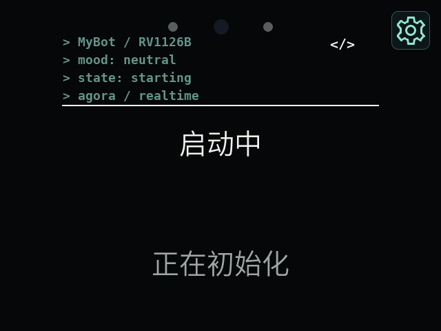
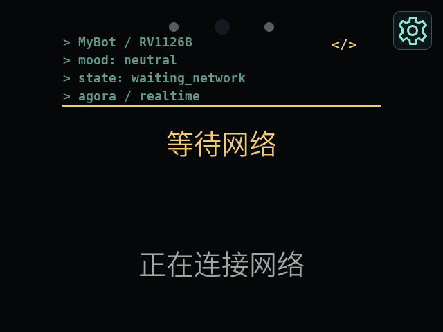
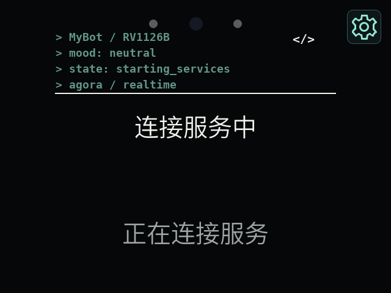
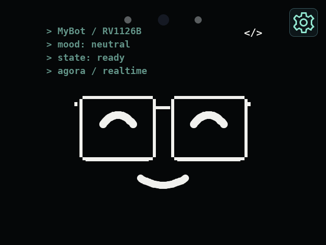

3. 已绑定设备最终显示像素眼镜和 `state: ready`；新设备显示配对码。就绪后不会自动开始对话，需要短触屏幕。

右上角齿轮是设置入口，在等待网络、配网和首次绑定期间也可使用。日常操作不需要接电脑。

<!-- page -->

# 10 用手机完成首次配网

1. 设备无法恢复已保存网络时，会自动进入 AP 配网；已有网络但要更换 Wi-Fi 时，点击右上角齿轮，再点“设备配网”。

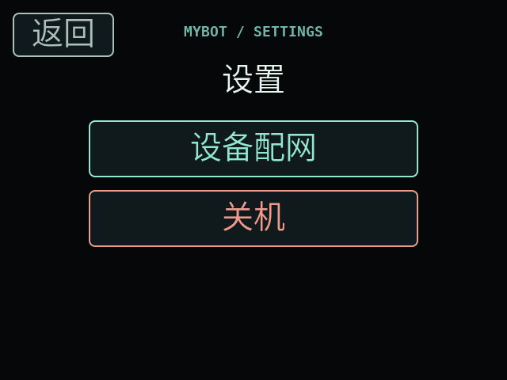
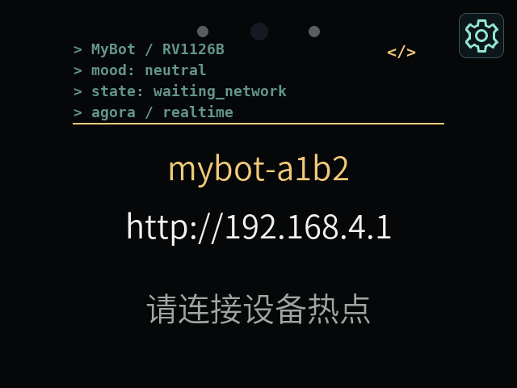

2. 在手机 Wi-Fi 设置连接屏幕上的 `mybot-xxxx` 热点。四位后缀由完整永久 MAC 的摘要生成，短后缀可能重复，以设备屏幕为准。热点不设密码；如提示“无互联网”，选择保持连接。
3. 等待自动弹出的页面；未弹出时，在手机浏览器手动输入 `http://192.168.4.1/`，使用 HTTP。
4. 选择可用的 2.4 GHz Wi-Fi，填写密码；隐藏网络可手动输入名称。开放网络留空密码。
5. 点击连接并等待结果。系统模式保存后还会验证关联、租约和路由，期间可能持续显示“正在连接”。
6. 页面显示“连接成功”后点击“完成”，或等待页面自动退出。热点随后关闭，设备启动业务；手机可切回原网络。

预期：设备从等待网络转为连接服务，最后显示配对码或 ready。单接口模式连接期间热点会短暂断开，失败时重新连回设备热点重试。手机显示成功不等于云端已就绪，仍需观察设备屏幕。

<!-- page -->

# 11 首次绑定与配对码

1. 配网成功后等待设备获取配对码。设备会显示并按当前保存音量播报；静音时不播音。

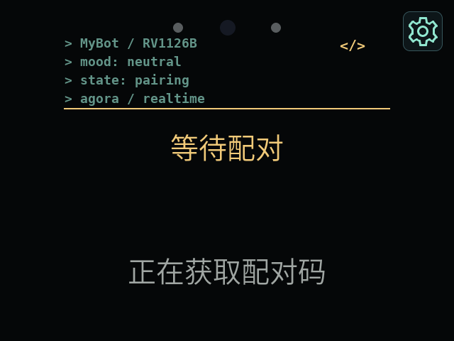
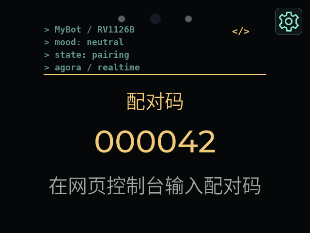

2. 将实际配置的服务器地址去掉末尾 `/api`，即为网页控制台地址。在手机或电脑浏览器打开该地址，登录对应账号。
3. 按控制台的设备认领流程，输入设备当前显示的完整配对码，包括前导零。图示 `000042` 不能用于真实设备。
4. 等待认领完成，观察设备进入 `state: ready`。如果码过期，使用设备新显示的码重试。

| 服务区 | 网页控制台地址 |
| --- | --- |
| 国内 | https://botstation.shengwang.cn |
| 国际 | https://botstation.agora.io |

例如，服务器为 `https://botstation.shengwang.cn/api` 时，打开 `https://botstation.shengwang.cn`。使用其他部署地址时，同样只去掉末尾 `/api`，保持其余地址不变。后续正常开机、升级及重新配网会复用原绑定，通常无需再次认领。

<!-- page -->

# 12 开始和结束语音对话

1. 在 ready 页面短触屏幕普通区域，避开右上角齿轮。短触有效时长为 50–999 ms，即正常点按。
2. 等待进入聆听状态后说话，观察顶部状态行变化。


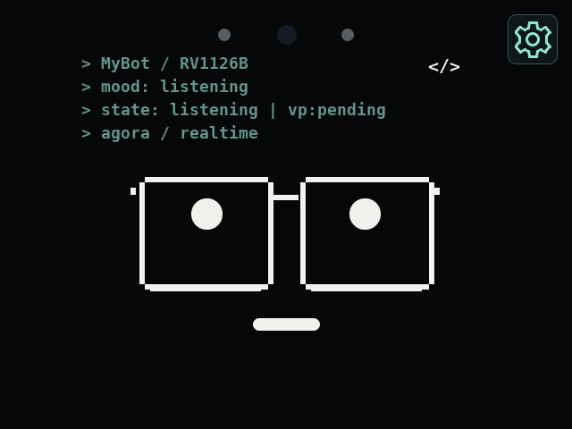
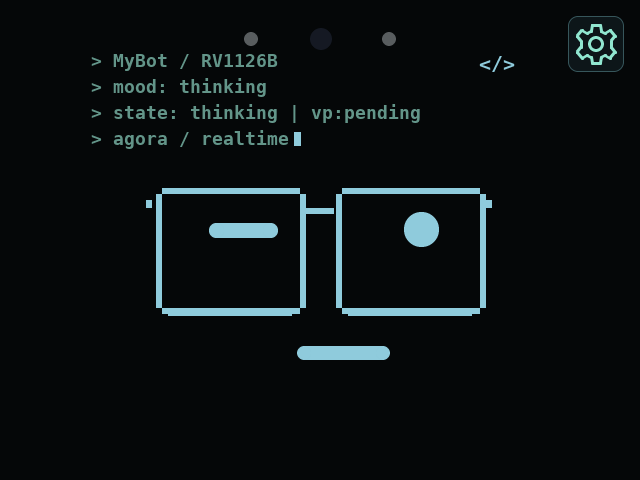
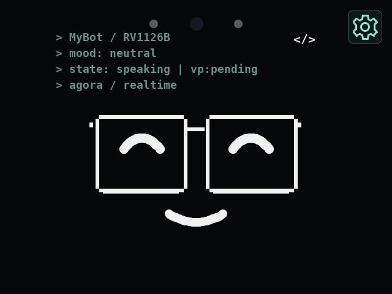

3. 再次短触普通区域结束对话，返回 ready。长按屏幕不会触发对话或配网。

`vp:pending` 表示声纹状态尚未登记完成，`vp:ok` 表示已完成，不需要单独点击。表情表示业务阶段，不代表实测麦克风音量。连续思考约 3 秒后可能显示 PROCESSING，这本身不是故障。

<!-- page -->

# 13 使用设置与重新配网

1. 点击主界面右上角齿轮，打开设置。点击左上角“返回”关闭设置；菜单内触摸不会开始或挂断对话。


2. 更换 Wi-Fi 时点击“设备配网”。应用先结束当前对话并停止 SDK，再进入手机 AP 配网流程。
3. 按第 10 节完成连接，等待设备恢复 ready；绑定继续保留，需要再次短触才开始新的对话。
4. 手机门户中的“已保存的网络”可设置默认项或删除记录，最多保存 10 项。新连接成功的网络成为默认；删除默认项后下一项成为默认。

手动配网只有设置入口。长按屏幕、终端 `w` 和旧 `--wifi-provision` 参数均不再提供配网功能。离线自动尝试已保存网络、失败后进入 AP 的策略仍然有效。

如果启动配置显式使用 `--no-wifi-provisioning`，自动和手动 AP 都被禁用，点击设置不会开启热点。正常受监督部署默认启用配网。

<!-- page -->

# 14 调整音量与理解语言设置

1. 通过服务侧支持的设备音量控制调整播放音量。当前设备只有一个实体电源键，屏幕设置中也没有音量滑块。
2. 检查静音、小音量和正常音量的实际播放效果。音量范围为 0–100，0 为静音；首次使用和恢复出厂后均为 70。
3. 重启应用或完成重新配网后，确认使用原来保存的音量。配网提示和配对码语音也使用保存的音量，静音时不发声。

| 设置 | 生效范围 |
| --- | --- |
| zh-CN / en-US 构建 | 决定设备 UI 文案、字库及未覆盖的默认服务区 |
| MYBOT_LOCALE | 仅选择包内提示音语言，不更换 UI，也不切换服务器 |
| 手机门户中文 / English | 只切换手机配网页面，不改变设备显示或语音 |
| --server / RV1126B_SERVER | 显式选择服务，优先于构建语言默认值 |

需要前台诊断时，维护人员可按第 17 节输入 `u` / `d` 调整音量。独立打开的 ADB shell 不是后台应用的终端，直接在其中敲 `u` / `d` 不会控制后台服务。

设备界面展示的是业务状态，未提供电量上报、亮度调节、自动休眠或 OTA 升级菜单。应用的播放音量控制不修改采集端 mixer；部署服务另有独立的板级采集初始化。

<!-- page -->

# 15 关机与再次开机

1. 点击右上角齿轮，选择“关机”，进入二次确认。
2. 尚不关机时点“取消”，返回设置；确定时点“确认关机”。

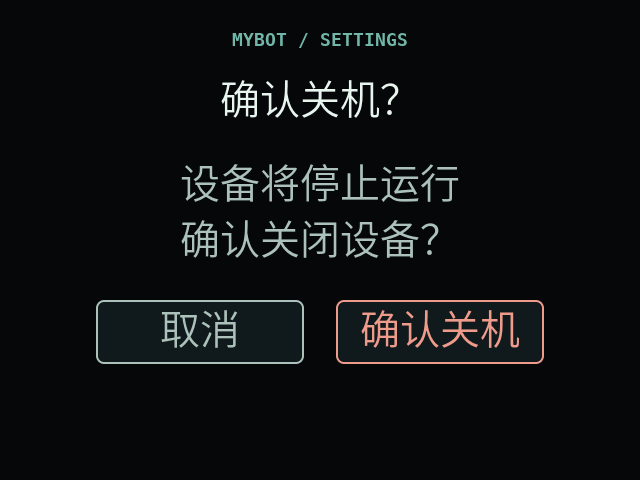
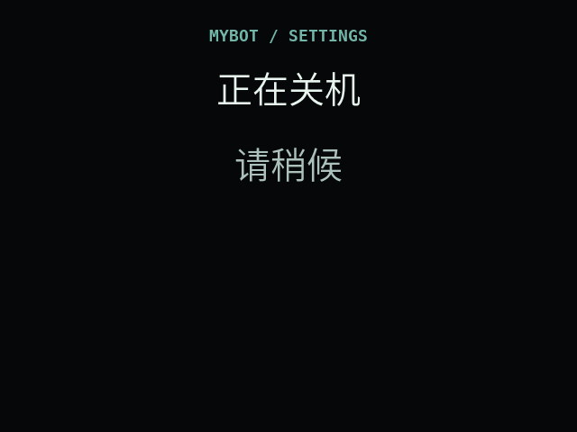

3. 等待应用清理资源并关闭显示输出，再由受监督关机脚本关闭背光、请求正常系统关机。不要反复按屏幕。
4. 再次使用时长按机身唯一实体按键，看到开机画面后松开；按住时长以硬件响应为准。

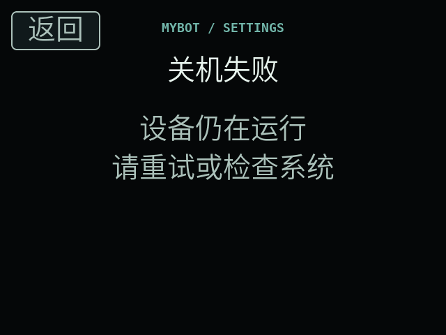

UI 关机需受监督的 `S99mybot`；请求被拒绝时可点左上角返回继续使用。

清理后由 `poweroff.sh` 关闭背光，再请求 `/sbin/poweroff`。准备中断或命令失败只尝试恢复背光值；应用退出后不恢复原 UI，请查私有日志并显式重启服务。

普通停止仍恢复原画面。软件关机不代表整机所有供电切断；实体长按的硬件链路仍未确认。

<!-- page -->

# 16 查询状态与维护服务

以下命令在主机执行，继续使用已选择的 `serial`。

1. 查询业务和监督状态，核对当前版本及版本链接。

```sh
python3 scripts/deploy-rv1126b.py status --serial "$serial"
adb -s "$serial" shell /etc/init.d/S99mybot status
adb -s "$serial" shell cat /run/mybot-rv1126b/application.status
adb -s "$serial" shell /userdata/mybot/current/run.sh --version
adb -s "$serial" shell readlink /userdata/mybot/current
adb -s "$serial" shell readlink /userdata/mybot/previous
```

首次安装没有 previous 时，最后一条可能不返回版本。`--version` 显示的是默认程序；服务是否选择视频还取决于私有配置中的 `RV1126B_VIDEO`。

2. 按维护需要选择一项操作，不必全部依次执行。

```sh
adb -s "$serial" shell /etc/init.d/S99mybot stop
adb -s "$serial" shell /etc/init.d/S99mybot start
adb -s "$serial" shell /etc/init.d/S99mybot restart
```

3. 设备异常时查看最近日志，在本地排查。

```sh
adb -s "$serial" shell tail -n 100 /userdata/mybot/logs/mybot.log
adb -s "$serial" shell date -u
adb -s "$serial" shell ip route
```

日志可能包含身份、热点名或配对信息，反馈前需脱敏。如果监督器存在 unclean 标记，不删除标记强行重启；按第 21 节处理资源清理问题。

<!-- page -->

# 17 前台调试与终端控制

仅在维护时使用；日常操作保持受监督服务运行。

1. 在主机停止服务，确认停止成功，再进入设备 shell。

```sh
adb -s "$serial" shell /etc/init.d/S99mybot stop
adb -s "$serial" shell
```

2. 在设备 shell 中加载原服务配置，保持同一服务地址、身份和数据目录，再启动前台应用。

```sh
. /etc/mybot-rv1126b.conf
/etc/mybot-rv1126b/audio-prepare.sh
cd /userdata/mybot/current
./run.sh
```

此步骤使用原服务的视频选项；未设置 `RV1126B_VIDEO` 时，直接执行 `./run.sh` 仍默认选择语音程序。

| 输入后按 Enter | 操作 |
| --- | --- |
| s / q | ready 时开始 / 会话中挂断 |
| u / d | 增加 / 减少保存的播放音量 |
| p | 请求重新配对，仅在确有需要时使用 |
| e 或 Ctrl-C | 正常退出应用 |

受监督服务的 stdin 为 `/dev/null`；这些命令只对前台应用所在终端有效。若配置禁用了终端输入，应使用正常屏幕或服务侧操作。

3. 前台正常退出后，在设备 shell 执行以下命令恢复后台服务，再退出 shell。

```sh
/etc/init.d/S99mybot start
exit
```

前台应用与后台服务不能并行运行。前台模式没有监督器的系统关机授权；退出后恢复后台服务，再使用屏幕关机。

<!-- page -->

# 18 升级应用与回退版本

1. 保留已验收旧包和原私有设置。源码变更需要分配新版本；同名 release 的不同归档不会覆盖安装。
2. 维护人员用版本工具更新版本，再重新编译和打包。以下 `X.Y.Z` 需换为实际新版本，不执行示例字母。

```sh
python3 scripts/project-version.py --set X.Y.Z
python3 scripts/project-version.py --check
```

3. 按第 04–08 节重建并部署，使用新的输出目录、包摘要和部署 tag。旧设备沿用原 settings，部署前要求绑定匹配。维护流程要求时先提交源码，再重建正式发布包。
4. 确认新版本进入 ready，并检查语音、设置、配网和音量后，记录包摘要及验收结果。

需要回退且设备已有 previous 时，在主机先预览再执行：

```sh
python3 scripts/deploy-rv1126b.py rollback \
  --serial "$serial" --settings local/deployment/settings.json \
  --dry-run
python3 scripts/deploy-rv1126b.py rollback \
  --serial "$serial" --settings local/deployment/settings.json \
  --execute --start
```

预期：切回 previous，使用同一数据目录和监督服务，原绑定复用。视频服务要求回退包包含 video 程序，不自动改用语音。回退不恢复旧 Wi-Fi/认证数据，也不自动启用原厂业务。首次安装无 previous 时，先向维护人员确认已安装的可用 release，不能凭空回退。

<!-- page -->

# 19 文件路径与持久化数据

程序与用户数据分开保存。更换程序版本时，保留身份、绑定、Wi-Fi 和音量数据。

| 设备路径 | 用途 |
| --- | --- |
| /userdata/mybot/releases/ | 独立的应用版本目录 |
| /userdata/mybot/current | 当前版本相对链接 |
| /userdata/mybot/previous | 上一个版本链接，首次安装可能不存在 |
| /userdata/mybot/backups/<tag>/original.tar.gz | 部署前备份，只保留在设备内 |
| /userdata/mybot/logs/mybot.log | 当前服务日志，另有轮转文件 |
| /userdata/mybot-rv1126b/device_auth | 应用绑定及认证记录，包含敏感信息 |
| /userdata/mybot-rv1126b/volume.settings | 保存的播放音量 |
| /etc/wpa_supplicant.conf | 受监督部署的系统 Wi-Fi 主记录 |
| /userdata/mybot-rv1126b/wifi/wifi.credentials | 独立私有 Wi-Fi 模式的记录；系统模式以系统主记录为准 |
| /etc/init.d/S99mybot | 服务启停和开机入口 |
| /etc/mybot-rv1126b.conf | root 私有服务配置，权限 0600 |
| /etc/mybot-rv1126b/ | 稳定监督程序、启动及音频准备脚本 |
| /run/mybot-rv1126b/application.status | 临时应用状态，重启后重建 |
| /run/mybot-network/leases/wlan0.lease | 临时租约代次记录，不含 Wi-Fi 密码 |
| /run/mybot-rv1126b-service/ | 监督控制和异常隔离标记 |

不要通过删除 `device_auth`、Wi-Fi 主记录或整个私有目录来解决启动问题。外发日志和问题记录前隐藏身份、配对码和凭据；保留备份在设备原有私有权限下。

<!-- page -->

# 20 网络、时间与启动故障

先记录当前版本、屏幕状态和失败附近日志，再按现象检查。


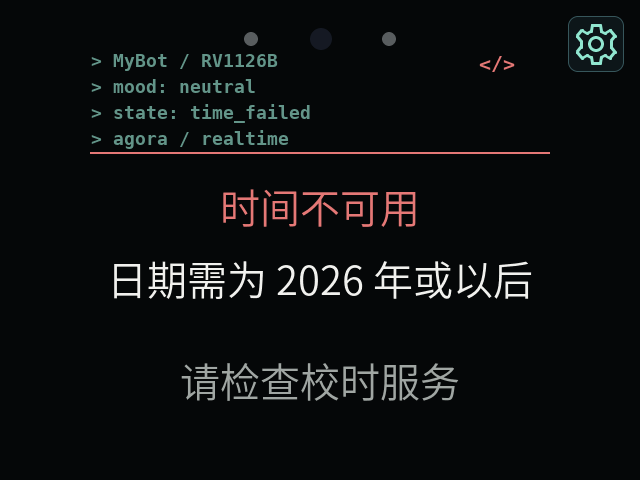

| 现象 | 操作与预期 |
| --- | --- |
| 等待网络一直不变 | 检查 Wi-Fi、IPv4、默认路由；可经设置重新配网。已联网但无租约记录时检查 dhcpcd hook |
| 手机不弹配网页 | 保持连接 mybot 热点，在浏览器打开 http://192.168.4.1/ |
| 密码错误 / 热点暂时消失 | 等待连接尝试结束；热点恢复后重新连接并重试 |
| 手机成功，设备仍等待 | 检查路由、DNS、时间及 CA；观察应用状态，不能只依据手机提示 |
| 系统时间 / 时间不可用 | 等待校时的设备会自动继续。出现错误时检查系统日期与校时服务，时间需不早于 2026-01-01 UTC |
| 连接服务失败 / TLS 错误 | 核对同一服务区的 HTTPS 地址、DNS、CA、系统时间及网络连通性 |

设备时间门槛只排除明显无效时间，不能证明精确 NTP 同步。默认保留系统授时服务；需要可选 BusyBox helper 时由维护人员按时间指南配置，不在配网期间启动授时。

<!-- page -->

# 21 构建、部署与音频故障

| 现象 | 操作与预期 |
| --- | --- |
| 缺少 local/sdk/config.json | 完成第 03 节目标 SDK 配置；Ubuntu 主机依赖不能代替它 |
| 主机格式检查失败 | 使用 local/dev-tools 固定的 clang-format 11，修复实际报错 |
| 目标 ABI / RTSA 检查失败 | 核对 staging、manifest、完整 RTSA 与目标架构；不修改摘要绕过 |
| 打包提示过期或缺少变体 | 重建所选语言/profile；all 必须 voice、video 同源且都存在 |
| 同名包或 release 冲突 | 保留旧包，新输出目录重新打包；已安装同版本不同摘要需提升版本 |
| 身份不匹配 | 使用原服务地址和 ID，保持原数据；不删除绑定记录 |
| existing service / lock | 正常停止占用服务，确认进程退出；不并行运行应用 |
| ALSA busy / 无声音 | 检查声卡占用、保存音量是否为 0，以及日志中的 ALSA 错误 |
| 说话无响应 / AEC 异常 | 先确认进入 listening、网络正常，再核对板级采集策略与音频日志 |
| 屏幕关机失败 | 确认通过 S99mybot 受监督运行；前台模式不具备关机授权 |
| unclean / 自动重启被阻止 | 保留现场，检查遗留进程组、AP、音视频资源和私有日志，由维护人员安排恢复 |

出现 unclean 时，不删除标记强行绕过。需要重启设备清理内核资源时，由维护人员确认现场后执行；部署器不会自动重启。

问题反馈包含包名、SHA256、版本、语言/视频配置、复现步骤和脱敏日志。音质、AEC、手机接入及长期运行问题需要真实设备证据，主机测试无法替代。

<!-- page -->

# 22 视频检查与验收记录

摄像头程序已实现，但需独立验证，不能由语音通过推断视频通过。

1. 确认部署包包含 video 程序，设备 ISP 服务、V4L2 与 MPP 环境正常。启用前先保留可用语音版本。
2. 部署 settings 默认以 `video: true` 选择视频模式；语音部署显式设置 `video: false`。预览计划后执行，选择会写入服务配置，不是屏幕里的开关；按正常部署流程切换，避免多开实例。
3. 设备 ready 后短触屏幕开始会话，再验证云端首帧和接收。检查方向、颜色、最高 3 fps 的 640×480 JPEG；短触结束后检查停流，再次开始检查恢复及语音/UI 并发。仅进入 ready 不会出帧，程序不提供本地摄像头预览，也不自动保存快照。

每次安装或升级后按顺序验收，并记录包 SHA256、版本、日期和结果：

| 步骤 | 通过标准 |
| --- | --- |
| 1. 版本与启动 | 包校验正确；唯一业务实例；最终 ready 或新设备配对 |
| 2. 配网 | 手机可发现热点、拿到地址、提交并保存；完成后恢复业务 |
| 3. 绑定 | 完整配对码可认领；升级及重新配网不丢失原绑定 |
| 4. 语音 | 可反复开始/结束，双向收听正常，状态一致 |
| 5. 设置 | 齿轮和左上返回可用；长按不配网 |
| 6. 音量 | 静音/调节有效，重启和配网后恢复 |
| 7. 关机与开机 | UI 确认正常关机，机身按键可再次开机，自启动正常 |
| 8. 可选专项 | 视频、AEC、断网恢复及长期稳定性单独记录 |

工程内的详细参考：构建 `docs/user/build.zh-CN.md`，部署 `docs/user/deployment.zh-CN.md`，配网 `docs/user/wifi-provisioning.zh-CN.md`，配置 `docs/user/configuration.zh-CN.md`。当前已验证范围以 `docs/validation/README.md` 为准。

<!-- page -->

# 23 恢复出厂设置

1. 点击右上角齿轮，选择“恢复出厂设置”。确认页列出将清除的本机绑定、已保存的 Wi-Fi 和音量设置。点左上角“返回”可取消恢复。

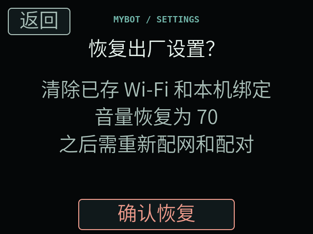

2. 松手后再次点击“确认恢复”。设备结束当前对话并重新启动 MyBot 服务。等待屏幕显示热点名称和网址。
3. 用手机连接屏幕上的热点，按第 10 节完成配网。按第 11 节使用新的配对码绑定。恢复后的音量为 70。

设备保留原 ID、服务地址、软件版本和视频设置。恢复可离线执行，断电后会在下次启动时继续处理。如果恢复未能开始，返回设置后重试。如果一直没有出现配网指引，请维护人员检查服务状态和日志。

管理员备份和日志仍会保留，可能含旧凭据。移交设备前，请原管理员在对应服务区控制台解除绑定并处理保留的备份和日志。
