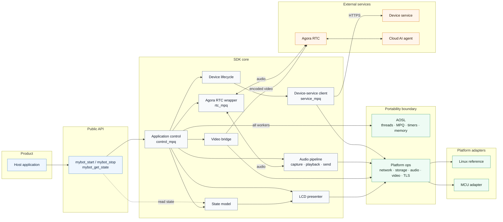

# mybot

[](LICENSE)

**[English](README.md) | [简体中文](README.zh-CN.md)**

`mybot` is a cross-platform **AI multimodal interaction SDK** for edge devices: it lets smart devices
send voice and optional device-camera video to cloud AI agents over Agora RTC for real-time
conversation and visual recognition. The platform/application owns
network provisioning and Wi-Fi credentials; the SDK consumes connectivity events and handles device
pairing and authentication, a conversation state machine, full-duplex voice interaction (Agora RTSA
with Agora AI capabilities), optional device-video uplink, button/LCD workflows, and optional local
wake-word recognition.
Platform-specific capabilities are injected through a small set of `ops` interfaces;
the SDK's language and runtime abstraction depends on C99 and AOSL, while RTC transport additionally
requires an [Agora RTSA SDK](https://doc.shengwang.cn/doc/rtsa/c/landing-page) built for the target
ABI. With those dependencies, it can be ported to platforms such as Linux, an RTOS, or a bare-metal
MCU.

> Current SDK version: **1.3.0**. This is a pinned Linux production subset;
> AOSL lives at `../aosl`, and Agora RTSA is supplied externally. They have separate terms; read
> [License and third-party dependencies](#license-and-third-party-dependencies) before using the
> SDK in a product.

## Table of Contents

- [Features](#features)
- [Conversation flow](#conversation-flow)
- [Boundaries and limitations](#boundaries-and-limitations)
- [Quick start](#quick-start)
- [Integrating into a host project](#integrating-into-a-host-project)
- [Build configuration](#build-configuration)
- [Architecture](#architecture)
- [Repository layout](#repository-layout)
- [Documentation](#documentation)
- [License and third-party dependencies](#license-and-third-party-dependencies)

## Features

- **Real-time AI conversation**: Hold live voice chats with a cloud AI agent; speech recognition,
  language-model reasoning, and speech synthesis (ASR / LLM / TTS) are orchestrated in the cloud.
- **Multimodal device input**: Optionally upload platform-encoded camera frames so the cloud AI agent
  can perform visual recognition alongside voice. JPEG, H.264, and H.265 are supported; video is
  uplink-only and the server does not send video back to the device.
- **Portable across supported targets**: The SDK's language and runtime abstraction depends on C99
  and AOSL, while RTC requires an Agora RTSA SDK built for the target ABI. Device capabilities are
  injected through the `ops` contract, so the core never touches an OS or peripheral API directly.
- **Connectivity integration**: The product owns provisioning; the SDK observes the usable network
  and its runtime disconnect/reconnect events.
- **Pairing and authentication**: Pair code → device claim → persisted long-lived credential, with
  automatic re-pairing when authentication is rejected.
- **Conversation state machine**: Five device-service lifecycle states — `unprovisioned / pairing /
  awaiting_claim / runtime / in_conversation` — drive the device-server interaction.
- **Application lifecycle state**: `mybot_get_state()` exposes startup, device pairing, connectivity,
  shutdown, and conversation state; the values are defined in [mybot.h](include/mybot/mybot.h).
- **Full-duplex voice · barge-in**: Uplink and downlink run simultaneously; the user can interrupt
  the AI mid-reply at any time, and the microphone keeps streaming so the cloud agent hears and
  responds to new input.
- **Full-duplex voice interaction · Agora AI capabilities**: Built on Agora RTSA, with cloud AEC and
  AI QoS.
- **Volume control**: The SDK owns volume. When the platform registers a real-device volume
  implementation (codec / amplifier / mixer), volume changes drive hardware volume directly; otherwise
  the SDK falls back to a digital software gain applied to playback PCM. There is no
  application-facing volume API.
- **Optional local wake words**: Off by default; wake behavior is identical to starting a
  conversation with a physical button.
- **Button and LCD workflows**: Semantic screen states (waiting for network / pairing / pair code / ready /
  in conversation); how each is displayed is up to the platform.
- **Voiceprint registration status**: During an active conversation, the SDK listens on the
  conversation RTM channel for the server's `message.sal_status` / `VP_REGISTER_SUCCESS` message
  and exposes `MYBOT_LCD_INDICATOR_VP_REGISTERED` as an in-conversation LCD overlay.
- **Cloud MCP device commands**: Receive session-bound DeviceCommand v1 messages over RTM to
  set playback volume with `audio.set_volume` or raise/lower it with `audio.adjust_volume`, using
  the cloud's `message.user` envelope.
  The cloud owns MCP tool invocation; the SDK reuses the same playback-volume path used by volume
  keys. Integration is described in [PORTING.md](docs/PORTING.md#mcp-device-commands).
- **Pairing-code voice prompt**: Once per pair code, plays a fixed prompt ("Please enter the
  pairing code in the console") followed by one sound per digit through the normal speaker path. Assets are raw
  16 kHz mono s16 PCM files under `./assets/locales/<locale>/` (`prompt.pcm`, `0.pcm`..`9.pcm`);
  the platform owns them and the SDK core contains no audio decoder.
- **HTTPS transport**: The device service accepts HTTPS only by default. Linux uses OpenSSL; MCU
  platforms may integrate mbedTLS or a vendor TLS and must validate the certificate chain and host
  name.

## Boundaries and limitations

- Audio is fixed at 16 kHz, mono, 16-bit PCM; `ptime` is configurable to 20/40/60 ms (default
  60 ms).
- Video uplink is optional and uses platform-owned JPEG, H.264, or H.265 encoding. The SDK does not
  encode, decode, buffer, or receive video; it sends one primary encoded stream to the cloud agent.
- The RTC implementation is specific to Agora RTSA; no other RTC protocol adapter is provided.
- Local ASR wake words are an optional platform implementation, off by default; enabling them
  requires the platform to register an implementation.
- The platform/application owns network provisioning and Wi-Fi credential storage; the SDK consumes only
  connectivity events through the Wi-Fi interface.
- The device server is not part of this repository; running the examples requires a compatible
  server endpoint.

## Conversation flow

The device sends 16 kHz PCM and optional platform-encoded video over Agora RTC. The cloud agent
handles ASR, LLM, TTS, and visual recognition, while the SDK plays returned audio locally. Uplink
and downlink run concurrently, so a new user utterance can interrupt an active reply. The
device-service client manages pairing and conversation requests; the service allocates each
session and is not part of this repository.

## Quick start

Build and run this application from its [project entry point](../../README.md).
This SDK snapshot retains the core, public headers, Linux adapters and prompt assets.
Upstream examples, tests and repository/release tooling are omitted. The parent
integration fixes `MYBOT_BUILD_EXAMPLES=OFF` and `MYBOT_BUILD_TESTS=OFF`.

## Integrating into a host project

The parent application provides the pinned sibling AOSL source tree through `AOSL_DIR`;
there are no nested submodules. Its [SDK integration](../../cmake/dependencies/sdk.cmake)
creates one `aosl` target through MyBot. The host supplies Agora RTSA headers and a
shared or static library matching the target architecture. This snapshot retains Linux only.

An installed package is also supported: `cmake --install` exports `mybot::sdk` (and the bundled
`mybot::aosl`), and a consumer project can use `find_package(mybot CONFIG REQUIRED)` after pointing
`MYBOT_AGORA_SDK_DIR` / `MYBOT_AGORA_RTC_LIBRARY` at a target-architecture Agora RTSA package.

```cmake
set(CONFIG_PLATFORM linux CACHE STRING "" FORCE)
set(AOSL_DIR "${PROJECT_SOURCE_DIR}/third_party/aosl" CACHE PATH "" FORCE)
set(AGORA_SDK_DIR /opt/agora-rtsa CACHE PATH "" FORCE)
set(AGORA_RTC_LIBRARY /opt/agora-rtsa/lib/libagora-rtc-sdk.so CACHE FILEPATH "" FORCE)

set(MYBOT_BUILD_LINUX_PLATFORM OFF CACHE BOOL "" FORCE)
set(MYBOT_BUILD_EXAMPLES OFF CACHE BOOL "" FORCE)
set(MYBOT_BUILD_TESTS OFF CACHE BOOL "" FORCE)
set(MYBOT_AUDIO_PTIME_MS 20 CACHE STRING "" FORCE)
set(MYBOT_WAKE_WORDS OFF CACHE BOOL "" FORCE)
set(MYBOT_ENABLE_HTTPS ON CACHE BOOL "" FORCE)

add_subdirectory(third_party/mybot)
target_link_libraries(device_firmware PRIVATE mybot::sdk)
```

Register one `mybot_platform_descriptor_t` before `mybot_start()`. A non-NULL ops pointer is the sole
declaration that the platform supports that function. Registration validates the complete descriptor,
including the required Wi-Fi, KV, key, capture, and playback tables, before committing the complete
descriptor.
`mybot_start()` then checks the ops required by the active build and runtime configuration before
creating any platform resources. Every platform is submitted through this one descriptor. For the
full implementation order, minimal code, threading constraints, and acceptance checklist, see
[docs/PORTING.md](docs/PORTING.md).

The product completes network provisioning before starting MyBot and stops MyBot before entering
provisioning again. The SDK owns device-service pairing and conversations, independently of that
network setup. See [PORTING: start and stop](docs/PORTING.md#step-6-start-and-stop) for the
integration sequence and example, and [mybot.h](include/mybot/mybot.h) for the API contract.

Agora RTSA is external to this source snapshot. Shared-library consumers must deploy
`libagora-rtc-sdk.so` through the application packaging flow and make it discoverable through
RPATH or the runtime loader; the MyBot CMake install target does not install that dependency.

## Build configuration

The following options can be set via the CMake command line or cache variables before the host's
`add_subdirectory()` call:

| Option | Default | Description |
| --- | --- | --- |
| `MYBOT_AUDIO_PTIME_MS` | `60` | Audio packet duration; accepts only 20, 40, 60 ms |
| `MYBOT_CLOUD_AEC` | `ON` | Server-side AEC; the uplink carries mic and reference channels |
| `MYBOT_WAKE_WORDS` | `OFF` | Enable the platform local-ASR wake-word implementation |
| `MYBOT_ENABLE_VIDEO` | `OFF` | Enable platform-encoded JPEG/H.264/H.265 video uplink |
| `MYBOT_VIDEO_MAX_FRAME_BYTES` | `524288` | Maximum encoded video frame accepted by the SDK |
| `MYBOT_AI_QOS` | `ON` | Agora AI QoS |
| `MYBOT_FAST_SEND_MULTIPLIER` | `3` | Fast-send multiplier; accepts only 1–5 |
| `MYBOT_ENABLE_HTTPS` | `ON` | Enable the platform HTTPS transport; keep ON for production builds |
| `MYBOT_ALLOW_INSECURE_HTTP` | `OFF` | Local development only: explicitly allow plaintext HTTP |
| `MYBOT_ENABLE_ASAN` | `OFF` | GCC/Clang AddressSanitizer; recommended for host tests |
| `MYBOT_ENABLE_UBSAN` | `OFF` | GCC/Clang UndefinedBehaviorSanitizer; recommended for host tests |
| `MYBOT_ENABLE_COVERAGE` | `OFF` | Instrument mybot targets for gcov |

Two independent variables select platform code: `CONFIG_PLATFORM` chooses the AOSL HAL port
consumed by [AOSL](../aosl) (only `linux` is retained here), while `MYBOT_BUILD_LINUX_PLATFORM`
builds the complete Linux adapters (`platforms/linux/`: ALSA, stdin, file KV, console LCD, OpenSSL).
The parent keeps that option OFF and builds only its required Linux services.

`MYBOT_AUDIO_PTIME_MS` must match the RTSA package's
`CONFIG_MINIMAL_TIMER_INTERVAL_MS` setting. Supply a matching external package with
`AGORA_SDK_DIR` and `AGORA_RTC_LIBRARY`. The application fixes 20 ms in its integration;
60 ms in the table above remains the unmodified SDK default. CMake checks the package's `.config` or `include/global_config.cmake` and
rejects a mismatch; packages without this build metadata are rejected. When a parent project
predefines the Agora imported target, set `AGORA_SDK_DIR` to that same package so the check still
has a verifiable source of truth. CMake cannot inspect an imported target's ABI; the parent project
must ensure its include and library paths refer to this same package.

Use the application build scripts to configure the external target package and pinned dependencies.

The Linux reference platform has no local ASR implementation, so enabling `MYBOT_WAKE_WORDS`
requires the host to register an additional implementation; otherwise the app fails to start with a
clear error.

Plaintext HTTP never falls back automatically. Only in an isolated local development environment may
you configure `-DMYBOT_ENABLE_HTTPS=OFF -DMYBOT_ALLOW_INSECURE_HTTP=ON`. This combination transmits
device credentials and RTC parameters in cleartext and must not be used on devices, shared
networks, or release builds.

## Architecture

The SDK uses a layered architecture: the host application drives the core through the public API,
the core modules sit on top of the AOSL portability layer and the platform `ops` contract, and all
platform differences are absorbed by the platform implementations. The device server, the Agora RTC cloud,
and the cloud AI agent are runtime external dependencies and are not part of this repository.



Layer notes:

- **Public API** ([include/mybot/mybot.h](include/mybot/mybot.h)): application lifecycle and
  state queries (`mybot_start` / `mybot_is_running` / `mybot_get_state` / `mybot_stop`);
  non-blocking startup. Use `mybot_get_state()` for key or UI decisions:
  `MYBOT_STATE_READY` can start a conversation and `MYBOT_STATE_IN_CONVERSATION` can stop one;
  `MYBOT_STATE_PAIRING` is not conversation-ready. LCD output is only a rendering result, not a
  source of lifecycle state. Conversation and pairing actions are triggered by platform key /
  wake-word events and handled inside the SDK core. Wi-Fi and device-lifecycle events update one
  atomic state-model snapshot; `mybot_get_state()` and the LCD presenter derive their views from
  that same snapshot.
- **SDK core** ([src/](src/)): one control owner serializes application state, the device lifecycle,
  UI and volume actions, and resource startup and shutdown. RTC commands are forwarded synchronously
  to the dedicated `rtc_mpq`, which serializes RTSA lifecycle, vendor calls, and callbacks. Control
  callbacks only publish short events or atomic mailboxes to their owner. The core also contains the
  device-service HTTP client, the Agora RTSA session wrapper, audio ring buffers, the optional video
  uplink bridge, and the optional local wake-word engine. Core code never touches any OS or
  peripheral API directly.
- **Foundation layer**: AOSL provides portable threads / MPQ queues / timers / logging; the
  platform `ops` contract defines the device capabilities the SDK requires. Both are implementable
  per platform.
- **Platform implementations**: the Linux reference implementation and each MCU platform register
  against the same contract.
- **External services**: the device server (pairing / claim / session scheduling, HTTPS only), the
  Agora RTC cloud (real-time audio and optional video transport), and the cloud AI agent (speech
  recognition / understanding / synthesis / visual recognition).

### Execution model

One control owner serializes lifecycle and UI actions. Background device-service requests, RTC,
capture, playback, and audio sending use separate workers. Platform callback ownership, startup and
shutdown ordering, and acceptance requirements are defined in
[PORTING](docs/PORTING.md); thread budgets and timing constraints are defined in
[EMBEDDED](docs/EMBEDDED.md).

## Repository layout

```text
mybot/
├── include/mybot/          # public API and platform contracts
├── src/                    # core; internal/ is private
├── platforms/linux/        # complete Linux adapter sources
├── assets/locales/         # pairing-code PCM prompts
├── docs/                   # API porting/resource guidance and Doxygen template
└── cmake/                  # SDK package and RTSA packet-time templates
```

`mybot::sdk` links the sibling `aosl` target and externally configured Agora RTSA.
The application compiles the four Linux services it uses separately; other adapters remain
available as SDK integration reference material.

## Documentation

This repository maintains the SDK core and Linux reference implementation. Product integrations
supply their platform adapters, board configuration, and firmware builds.

- [Public headers](include/mybot/) — authoritative API and platform contracts; this README is the overview
- [docs/PORTING.md](docs/PORTING.md) ([简体中文](docs/PORTING.zh-CN.md)) — porting guide and
  integration sequence and acceptance checklist
- [docs/EMBEDDED.md](docs/EMBEDDED.md) ([简体中文](docs/EMBEDDED.zh-CN.md)) — footprint, memory,
  thread/stack, timing, power and logging guidance for MCU integrators
- API reference — generated by Doxygen from the public headers with
  `doxygen build/docs/Doxyfile` after configuring the SDK

## License and third-party dependencies

Our own code is released under the Apache License 2.0 in the root [LICENSE](LICENSE). This does not
change the licensing of third-party components:

- AOSL carries additional conditions listed in [AOSL LICENSE](../aosl/LICENSE).
- Agora RTSA is supplied externally and requires its applicable vendor authorization; the
  upstream package audit record remains in the notices, but that x86_64 binary is not included here.
- `mybot_json` is derived from cJSON and retains the MIT license notice.

Verify these terms independently before shipping or redistributing a product. See
[THIRD_PARTY_NOTICES.md](THIRD_PARTY_NOTICES.md) for details.
