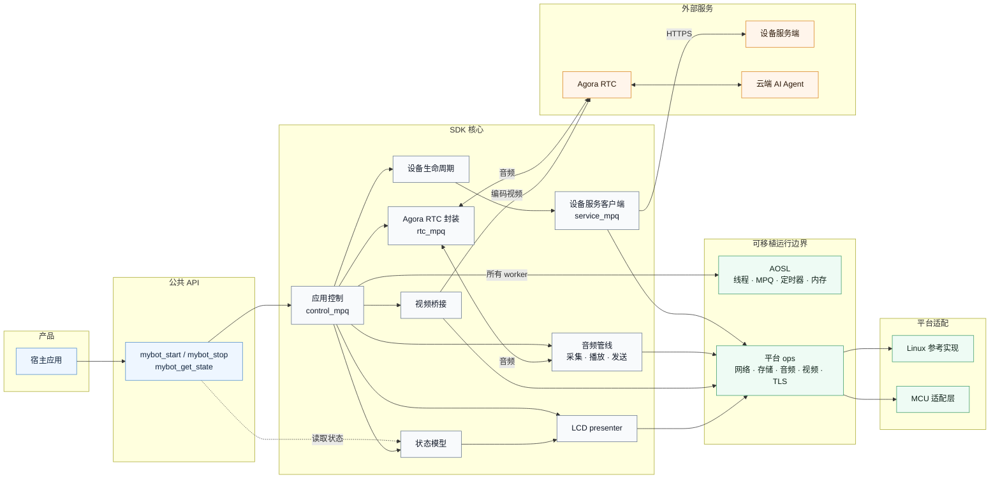

# mybot

[](LICENSE)

**[English](README.md) | 简体中文**

`mybot` 是面向设备端的跨平台 **AI 多模态交互 SDK**：让智能设备通过声网 Agora RTC 将
语音和可选的设备摄像头视频发送给云端 AI Agent，进行实时对话和视觉识别。平台/应用负责
配网流程和 Wi-Fi 凭据；SDK 消费网络
连接事件，并负责设备配对与认证、会话状态机、全双工语音交互（Agora RTSA 与 Agora AI
能力）、可选的设备视频上行、按键/LCD 工作流以及可选的本地唤醒词识别。平台相关能力通过
一组小型 `ops` 接口注入。SDK 的语言与运行时抽象依赖 C99 与 AOSL；RTC 传输额外要求目标
ABI 对应的 [Agora RTSA SDK](https://doc.shengwang.cn/doc/rtsa/c/landing-page)。在这些依赖
就绪时，可移植到 Linux、RTOS 或裸机 MCU 等平台。

> 当前 SDK 版本为 **1.3.0**。此处为固定的 Linux 生产子集；AOSL 位于平级 `../aosl`，
> Agora RTSA 由外部提供，均有独立许可及使用条件；用于产品前请阅读[许可证与第三方依赖](#许可证与第三方依赖)。

## 目录

- [功能特性](#功能特性)
- [对话流程](#对话流程)
- [边界与限制](#边界与限制)
- [快速开始](#快速开始)
- [集成到宿主工程](#集成到宿主工程)
- [构建配置](#构建配置)
- [系统架构](#系统架构)
- [仓库结构](#仓库结构)
- [文档](#文档)
- [许可证与第三方依赖](#许可证与第三方依赖)

## 功能特性

- **AI 实时对话**：与云端 AI Agent 进行实时语音聊天，语音识别 / 大模型理解 / 语音合成
  （ASR / LLM / TTS）由云端编排。
- **多模态设备输入**：可选上传由平台编码的摄像头视频，让云端 AI Agent 结合语音进行
  视觉识别。支持 JPEG、H.264、H.265；视频仅上行，服务端不会向设备端发送视频。
- **面向受支持目标可移植**：SDK 的语言与运行时抽象依赖 C99 与 AOSL，RTC 额外要求目标
  ABI 对应的 Agora RTSA SDK。设备能力通过 `ops` 契约注入，核心不直接触碰 OS 或外设 API。
- **网络连接集成**：产品负责配网，SDK 监听可用网络及运行期间的断线、重连事件。
- **配对与认证**：配对码 → 设备认领 → 长期凭证持久化，认证失效时自动重新配对。
- **会话状态机**：`unprovisioned / pairing / awaiting_claim / runtime / in_conversation` 五态
  设备服务生命周期驱动设备服务端交互。
- **应用生命周期状态**：`mybot_get_state()` 暴露启动、设备配对、网络、停止与会话状态，
  各状态含义以 [mybot.h](include/mybot/mybot.h) 为准。
- **全双工语音 · 支持打断**：上行与下行同时进行；AI 回复期间用户可随时说话打断，
  麦克风持续上行，云端 Agent 感知新输入并即时响应。
- **全双工语音交互 · Agora AI 能力**：基于 Agora RTSA，支持云端 AEC 与 AI QoS。
- **音量控制**：SDK 统一管理播放音量。平台注册设备真实音量实现（Codec / 功放 / 混音器）
  时，音量变化直接驱动硬件；未注册或初始化失败时，回退为对播放 PCM 应用软件增益。
- **可选的本地唤醒词**：默认关闭；唤醒行为与物理按键启动会话一致。
- **按键与 LCD 工作流**：语义化屏幕状态（等待网络 / 配对 / 配对码 / 就绪 / 会话中），显示方式由
  平台决定。
- **声纹注册状态**：对话过程中监听当前会话 RTM channel 的
  `message.sal_status` / `VP_REGISTER_SUCCESS` 消息，并通过
  `MYBOT_LCD_INDICATOR_VP_REGISTERED` 向 LCD 提供会话内叠加指示。
- **云端 MCP 设备命令**：通过 RTM 接收绑定当前会话的 DeviceCommand v1 消息，控制播放
  音量，支持 `message.user` 封装内的 `audio.set_volume` 及增大/减小音量的
  `audio.adjust_volume`。MCP 工具调用由云端负责，SDK
  复用与音量按键相同的播放音量路径。集成说明见
  [PORTING.zh-CN.md](docs/PORTING.zh-CN.md#mcp-设备命令)。
- **配对码语音播报**：每个配对码只播报一次，先播固定提示句（“请在控制台输入配对码”），
  再逐位播报数字，走正常扬声器链路。音频资源为 `./assets/locales/<locale>/` 下的原始 16 kHz
  单声道 16-bit PCM 文件（`prompt.pcm`、`0.pcm`~`9.pcm`），由平台持有，SDK 核心不含解码器。
- **HTTPS 安全传输**：设备服务默认仅接受 HTTPS；Linux 使用 OpenSSL，MCU 可接入
  mbedTLS 或芯片厂商 TLS，并校验证书链与主机名。

## 边界与限制

- 音频格式固定为 16 kHz、单声道、16-bit PCM；`ptime` 可配置为 20/40/60 ms，默认
  60 ms。
- 视频上行可选，由平台负责 JPEG、H.264 或 H.265 编码。SDK 不编码、解码或缓存视频，
  只向云端发送一个主视频流。
- RTC 实现专用于 Agora RTSA，不提供其他 RTC 协议适配层。
- 本地 ASR 唤醒词为可选平台实现，默认关闭；开启时必须由平台注册实现。
- 配网流程和 Wi-Fi 凭据由平台/应用负责，SDK 的 Wi-Fi 接口只消费网络连接状态事件。
- 设备服务端不属于本仓库；运行示例与联调需要兼容的服务端地址。

## 对话流程

设备通过 Agora RTC 上送 16 kHz PCM 和可选的平台编码视频。云端 Agent 负责 ASR、LLM、TTS
和视觉识别，SDK 在本地播放返回音频。上行与下行同时运行，新语音可以打断正在播放的回复。
设备服务客户端负责配对流程与会话请求；每次会话由服务端分配，服务端实现不属于本仓库。

## 快速开始

通过[项目入口](../../README.zh-CN.md)构建、运行应用。此 SDK 快照保留核心、公共头文件、
完整 Linux adapter 和提示音资源，省略上游示例、测试及仓库/发布工具。父工程固定
`MYBOT_BUILD_EXAMPLES=OFF`、`MYBOT_BUILD_TESTS=OFF`。

## 集成到宿主工程

父工程通过 `AOSL_DIR` 指定平级的固定 AOSL 源码，无嵌套 submodule。
[SDK 集成](../../cmake/dependencies/sdk.cmake)继续由 MyBot 创建唯一的 `aosl` target。
宿主为目标架构准备匹配的 Agora RTSA 头文件及共享库或静态库；此快照仅保留 Linux。

也支持已安装包：`cmake --install` 会导出 `mybot::sdk`（及随附的 `mybot::aosl`），消费工程将
`MYBOT_AGORA_SDK_DIR` / `MYBOT_AGORA_RTC_LIBRARY` 指向目标架构的 Agora RTSA 包后，即可用
`find_package(mybot CONFIG REQUIRED)` 引入。

```cmake
set(CONFIG_PLATFORM linux CACHE STRING "" FORCE)
set(AOSL_DIR "${PROJECT_SOURCE_DIR}/third_party/aosl" CACHE PATH "" FORCE)
set(AGORA_SDK_DIR /opt/agora-rtsa CACHE PATH "" FORCE)
set(AGORA_RTC_LIBRARY /opt/agora-rtsa/lib/libagora-rtc-sdk.so CACHE FILEPATH "" FORCE)

set(MYBOT_BUILD_LINUX_PLATFORM OFF CACHE BOOL "" FORCE)
set(MYBOT_BUILD_EXAMPLES OFF CACHE BOOL "" FORCE)
set(MYBOT_BUILD_TESTS OFF CACHE BOOL "" FORCE)
set(MYBOT_AUDIO_PTIME_MS 20 CACHE STRING "" FORCE)
set(MYBOT_WAKE_WORDS OFF CACHE BOOL "" FORCE)
set(MYBOT_ENABLE_HTTPS ON CACHE BOOL "" FORCE)

add_subdirectory(third_party/mybot)
target_link_libraries(device_firmware PRIVATE mybot::sdk)
```

平台应在 `mybot_start()` 之前注册一个 `mybot_platform_descriptor_t`。非空 ops 指针是平台
支持对应功能的唯一声明。注册过程会完整校验描述符，包括必需的 Wi-Fi、KV、按键、采集和
播放回调表，然后一次性提交完整描述符；`mybot_start()` 再按当前构建与运行配置检查所需 ops，并在创建
任何平台资源之前拒绝缺失项。所有平台功能均通过这个描述符一次性注册，不再提供独立的分项
注册入口。完整实现顺序、最小代码、线程约束和验收清单见
[docs/PORTING.zh-CN.md](docs/PORTING.zh-CN.md)。

产品先完成配网，再启动 MyBot；重新进入配网前先停止 MyBot。SDK 负责的设备服务配对
和会话与网络配网相互独立。集成顺序与代码示例见
[PORTING：启动与停止](docs/PORTING.zh-CN.md#第-6-步启动与停止)，
API 契约以 [mybot.h](include/mybot/mybot.h) 为准。

Agora RTSA 位于源码快照之外。共享库使用方通过应用打包流程部署 `libagora-rtc-sdk.so`，
并通过 RPATH 或运行时加载器确保系统能够找到它；MyBot 的 CMake 安装目标不会安装该依赖。

## 构建配置

以下选项可在宿主 `add_subdirectory()` 之前通过 CMake 命令行或缓存变量设置：

| 选项 | 默认值 | 说明 |
| --- | --- | --- |
| `MYBOT_AUDIO_PTIME_MS` | `60` | 音频包长，只接受 20、40、60 ms |
| `MYBOT_CLOUD_AEC` | `ON` | 服务端 AEC；上行包含麦克风和参考声道 |
| `MYBOT_WAKE_WORDS` | `OFF` | 启用本地 ASR 唤醒词平台实现 |
| `MYBOT_ENABLE_VIDEO` | `OFF` | 启用平台编码的 JPEG/H.264/H.265 视频上行 |
| `MYBOT_VIDEO_MAX_FRAME_BYTES` | `524288` | SDK 接受的单个编码视频帧最大字节数 |
| `MYBOT_AI_QOS` | `ON` | Agora AI QoS |
| `MYBOT_FAST_SEND_MULTIPLIER` | `3` | 快发倍数，只接受 1 到 5 |
| `MYBOT_ENABLE_HTTPS` | `ON` | 启用平台 HTTPS 传输，生产构建应保持开启 |
| `MYBOT_ALLOW_INSECURE_HTTP` | `OFF` | 仅本地开发：显式允许明文 HTTP |
| `MYBOT_ENABLE_ASAN` | `OFF` | GCC/Clang 地址消毒器，建议在宿主测试中开启 |
| `MYBOT_ENABLE_UBSAN` | `OFF` | GCC/Clang 未定义行为消毒器，建议在宿主测试中开启 |
| `MYBOT_ENABLE_COVERAGE` | `OFF` | 为 gcov 代码覆盖率插桩 |

两个相互独立的变量选择平台代码：`CONFIG_PLATFORM` 选择 [AOSL](../aosl) 消费的 AOSL HAL
端口（此快照仅保留 `linux`）；`MYBOT_BUILD_LINUX_PLATFORM` 构建完整 Linux adapter
（`platforms/linux/`：ALSA、stdin、文件 KV、控制台 LCD、OpenSSL）。父工程保持该选项 OFF，
单独编译所需的 Linux service。

`MYBOT_AUDIO_PTIME_MS` 必须与 RTSA 软件包中的
`CONFIG_MINIMAL_TIMER_INTERVAL_MS` 一致。通过 `AGORA_SDK_DIR` 和 `AGORA_RTC_LIBRARY`
提供匹配的外部软件包；应用集成固定为 20 ms，上表 60 ms 为未修改的 SDK 默认值。
CMake 会读取软件包的 `.config` 或 `include/global_config.cmake` 并拒绝不匹配的配置；缺少这些
构建元数据的软件包也会被拒绝。若宿主工程预先定义了 Agora 导入目标，仍需将
`AGORA_SDK_DIR` 设置为同一个软件包，以便校验有明确依据。
CMake 无法检查宿主预定义导入目标的 ABI；宿主必须确保该目标的头文件与库路径确实来自同一软件包。

通过应用构建脚本配置外部目标软件包与固定依赖。

Linux 参考平台没有本地 ASR 实现，开启 `MYBOT_WAKE_WORDS` 后需要由宿主额外注册实现，
否则应用会明确启动失败。

明文 HTTP 不会自动回退。仅在隔离的本地开发环境中，可显式配置
`-DMYBOT_ENABLE_HTTPS=OFF -DMYBOT_ALLOW_INSECURE_HTTP=ON`。该组合会以明文传输设备
凭据和 RTC 参数，不得用于设备、共享网络或发布构建。

## 系统架构

SDK 采用分层架构：宿主应用通过公共 API 驱动核心，核心模块建立在 AOSL 可移植运行层
与平台 `ops` 契约之上，平台差异全部由各平台实现收敛。设备服务端、Agora RTC 云与
云端 AI Agent 是运行时依赖的外部服务，均不在本仓库内。



分层说明：

- **公共 API**（[include/mybot/mybot.h](include/mybot/mybot.h)）：应用生命周期与状态
  查询（`mybot_start` / `mybot_is_running` / `mybot_get_state` / `mybot_stop`），非阻塞启动。
  按键或 UI 应通过 `mybot_get_state()` 判断动作：
  `MYBOT_STATE_READY` 时可开始会话，`MYBOT_STATE_IN_CONVERSATION` 时可停止会话；
  `MYBOT_STATE_PAIRING` 不允许开始会话。LCD 仅用于显示，不是生命周期状态来源。会话与配对
  动作由平台按键 / 唤醒词事件触发，由 SDK 核心内部处理。Wi-Fi 与设备生命周期事件共同更新
  一个原子状态模型快照；`mybot_get_state()` 与 LCD presenter 都从同一份快照派生各自视图。
- **SDK 核心**（[src/](src/)）：单一控制 owner 串行负责应用状态、设备生命周期、UI / 音量
  动作以及资源启停。RTC 命令同步转发到专用 `rtc_mpq`，由该线程串行执行 RTSA 生命周期、
  厂商调用和回调；控制回调只向各自 owner 投递短控制事件或原子 mailbox。核心还包含设备
  服务 HTTP 客户端、Agora RTSA 会话封装、音频环形缓冲、可选视频上行桥接与可选本地唤醒词。
  核心代码不直接触碰任何 OS 或外设 API。
- **基础服务层**：AOSL 提供线程 / MPQ / 定时器 / 日志等可移植能力；平台 `ops` 契约
  定义 SDK 所需的设备能力接口，两者都可由具体平台实现。
- **平台实现**：Linux 参考实现与各 MCU 平台按同一契约注册。
- **外部服务**：设备服务端（配对 / 认领 / 会话调度，仅 HTTPS）、Agora RTC 云（实时音频和
  可选视频传输）与云端 AI Agent（语音识别 / 理解 / 合成 / 视觉识别）。

### 执行模型

单一控制 owner 串行处理生命周期和界面操作；后台设备服务请求、RTC、采集、播放和音频发送
分别使用独立 worker。平台回调所有权、启停顺序与验收要求见
[PORTING.zh-CN.md](docs/PORTING.zh-CN.md)，线程预算与时序约束见
[EMBEDDED.zh-CN.md](docs/EMBEDDED.zh-CN.md)。

## 仓库结构

```text
mybot/
├── include/mybot/          # SDK 公共 API 与平台契约
├── src/                    # 核心；internal/ 为私有实现
├── platforms/linux/        # 完整 Linux adapter 源码
├── assets/locales/         # 配对码 PCM 提示音
├── docs/                   # API 移植/资源说明与 Doxygen 模板
└── cmake/                  # SDK package 与 RTSA 包时长模板
```

`mybot::sdk` 链接平级的 `aosl` target 和外部 Agora RTSA。
应用单独编译所需的四项 Linux service；其余 adapter 保留为 SDK 集成参考。

## 文档

本仓库维护 SDK 核心与 Linux 参考实现。产品集成方提供平台适配、板级配置与固件构建。

- [公共头文件](include/mybot/) — API 与平台接口契约的权威定义；本 README 保留项目概览
- [docs/PORTING.md](docs/PORTING.md)（[简体中文](docs/PORTING.zh-CN.md)）— 新平台移植指南
  的集成流程与验收清单
- [docs/EMBEDDED.md](docs/EMBEDDED.md)（[简体中文](docs/EMBEDDED.zh-CN.md)）— 面向 MCU
  集成者的体积、内存、线程/栈、时序、功耗与日志说明
- API 参考 — 由 Doxygen 从公共头文件生成，配置 SDK 后执行 `doxygen build/docs/Doxyfile`

## 许可证与第三方依赖

仓库自研代码按根目录 [LICENSE](LICENSE) 中的 Apache License 2.0 发布，但这不改变第三方
组件的许可：

- AOSL 带有其 [AOSL LICENSE](../aosl/LICENSE) 中列出的附加条件。
- Agora RTSA 由外部提供，使用和分发须遵循供应方授权；上游软件包审计记录保留在许可说明中，
  该 x86_64 二进制不包含在此快照内。
- `mybot_json` 派生自 cJSON，保留 MIT 许可声明。

发布产品或重新分发前必须单独核实这些条款。详见 [THIRD_PARTY_NOTICES.md](THIRD_PARTY_NOTICES.md)。
